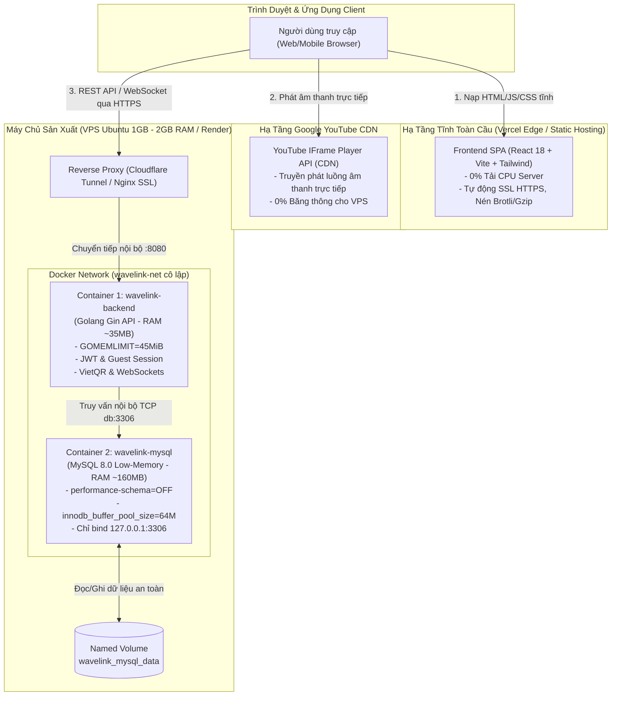
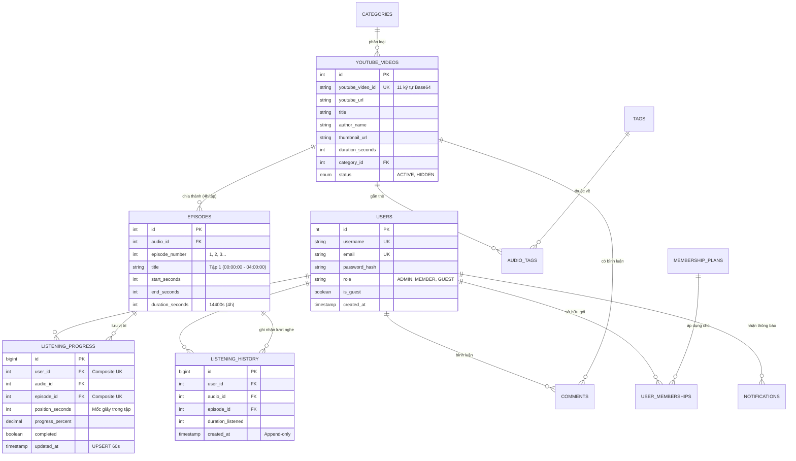
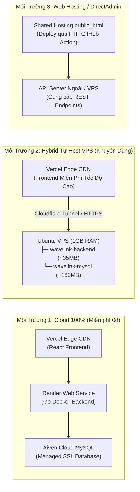
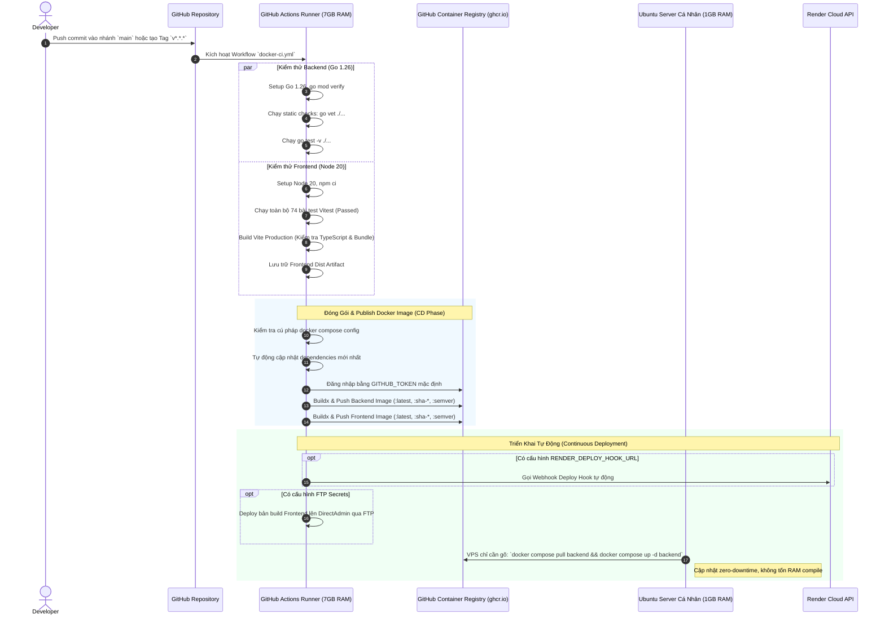

# 🎧 WAVELINK — NỀN TẢNG THƯ VIỆN ÂM THANH & TRUYỆN AUDIO TỪ YOUTUBE
### Hệ Thống Nghe Truyện Audio & Sách Nói Tối Giản — Zero Audio Hosting — Chuẩn Production CI/CD

<p align="center">
  
  
  
  
  
  
  
  
  
</p>

---

## 📖 MỤC LỤC

1. [Tổng Quan & Định Vị Hệ Thống](#1-tổng-quan--định-vị-hệ-thống)
2. [5 Nguyên Tắc Kỹ Thuật Bất Biến (Core Mandates)](#2-5-nguyên-tắc-kỹ-thuật-bất-biến-core-mandates)
3. [Kiến Trúc Kỹ Thuật Toàn Cảnh (System Architecture)](#3-kiến-trúc-kỹ-thuật-toàn-cảnh-system-architecture)
4. [Cấu Trúc Thư Mục Toàn Dự Án](#4-cấu-trúc-thư-mục-toàn-dự-án)
5. [Mô Hình Dữ Liệu (Database ERD & Storage)](#5-mô-hình-dữ-liệu-database-erd--storage)
6. [Hướng Dẫn Chạy Môi Trường Cục Bộ (Local Development)](#6-hướng-dẫn-chạy-môi-trường-cục-bộ-local-development)
7. [Chiến Lược Triển Khai Production (3 Môi Trường)](#7-chiến-lược-triển-khai-production-3-môi-trường)
   - [Môi trường 1: Cloud 100% Miễn Phí (Vercel + Render + Aiven)](#71-môi-trường-1-cloud-100-miễn-phí-vercel--render--aiven)
   - [Môi trường 2: Hybrid Tự Host VPS Cá Nhân (1GB - 2GB RAM)](#72-môi-trường-2-hybrid-tự-host-vps-cá-nhân-1gb---2gb-ram-khuyên-dùng)
   - [Môi trường 3: Web Hosting / DirectAdmin (FTP Auto-Deploy)](#73-môi-trường-3-web-hosting--directadmin-ftp-auto-deploy)
8. [Quy Trình Tự Động Hóa Production CI/CD (GitHub Actions)](#8-quy-trình-tự-động-hóa-production-cicd-github-actions)
9. [Danh Mục REST API & Tích Hợp Hệ Thống](#9-danh-mục-rest-api--tích-hợp-hệ-thống)
10. [Vận Hành, Tối Ưu Tài Nguyên & Khắc Phục Sự Cố](#10-vận-hành-tối-ưu-tài-nguyên--khắc-phục-sự-cố)
11. [Hệ Thống Tài Liệu Chuyên Sâu (Docs Sitemap)](#11-hệ-thống-tài-liệu-chuyên-sâu-docs-sitemap)

---

## 1. TỔNG QUAN & ĐỊNH VỊ HỆ THỐNG

**WaveLink** là nền tảng ứng dụng web hiện đại chuyên biệt cho việc quản lý, phân loại và thưởng thức các bộ truyện audio, sách nói, podcast dài tập từ YouTube mà **không cần tải về hay lưu trữ file MP3**.

### Các Tính Năng Nổi Bật:
- **Import Link YouTube Thông Minh:** Tự động trích xuất Video ID, khử độc URL chống SSRF, cào metadata qua YouTube oEmbed (0% Quota API).
- **Phân Đoạn Tập Logic (Logical Episodes 4 Giờ):** Tự động chia các luồng video siêu dài (từ 10 đến hơn 30 giờ) thành các tập logic gọn gàng (4 tiếng/tập), cho phép chọn tập và lưu mốc thời gian tức thì.
- **Tự Động Đồng Bộ Tiến Trình Nghe (Listening Progress):** Cơ chế UPSERT định kỳ 60 giây và khi tạm dừng/đóng trình duyệt, hỗ trợ tính năng Resume tiếp tục nghe đúng giây trước đó.
- **Bộ Điều Phối Tốc Độ Âm Thanh Độc Quyền (Playback Rate Coordinator):** Hỗ trợ đổi tốc độ thực x1.0, x1.5, x2.0 mượt mà; **khắc phục triệt để lỗi YouTube IFrame API tự động reset tốc độ về 1.0x khi đổi tập hoặc đổi audio**.
- **Hệ Thống Thành Viên VIP & Thanh Toán VietQR:** Nâng cấp gói hội viên tự động qua mã quét QR ngân hàng nội địa (VietQR) kèm mã giao dịch thông minh.
- **Trải Nghiệm Đa Dạng:** Nghe ẩn danh với Guest Session (không ép đăng nhập), hệ thống thông báo đa kênh, bảng tin cộng đồng (Community) và trình phát MiniPlayer hiện đại Neo-Brutalism.

---

## 2. 5 NGUYÊN TẮC KỸ THUẬT BẤT BIẾN (CORE MANDATES)

> [!IMPORTANT]
> Toàn bộ đội ngũ phát triển và kỹ sư vận hành bắt buộc phải tuân thủ nghiêm ngặt 5 nguyên tắc sau:

1. **Zero-Audio-Hosting (Không lưu MP3 vật lý):**
   * Server tuyệt đối **KHÔNG** tải về, không chuyển mã (transcode) và không lưu file `.mp3` trên đĩa cứng.
   * Âm thanh được truyền phát trực tiếp từ hạ tầng Google CDN thông qua **YouTube IFrame Player API** ẩn (Tiêu tốn **0% CPU** và **0% băng thông** máy chủ).
2. **Logical Segmentation (Phân đoạn logic mốc thời gian):**
   * Các tập được định nghĩa thuần túy bằng mốc toạ độ giây `start_seconds` và `end_seconds` trong bảng `episodes`.
3. **Stateless Backend & CSDL Tinh Gọn:**
   * Backend Golang được đóng gói thành Single Native Binary (<25MB), bộ nhớ chiếm dụng chỉ ~30MB - 50MB RAM.
   * Hỗ trợ chuyển đổi liền mạch giữa **SQLite WAL** (máy dev) và **MySQL 8.0 Low-Memory** (production).
4. **Resilient Rate Coordination (Duy trì tốc độ nghe):**
   * Tốc độ nghe của người dùng được lưu trữ persistent và khóa chủ động (`Intent Lock`) trong Zustand Store, tự động tái thiết lập trên Player instance mới qua cơ chế Bounded Retry.
5. **Ưu Tiên Chi Phí Vận Hành Thấp (Low-Resource First):**
   * `Correctness > Legal Compliance > Security > Low Resource (VPS 1GB RAM) > Simplicity > Performance`.

---

## 3. KIẾN TRÚC KỸ THUẬT TOÀN CẢNH (SYSTEM ARCHITECTURE)

Hệ thống áp dụng mô hình phân tách hoàn toàn giữa **Static Frontend** (phân phối qua Global Edge CDN) và **API Services / Database** (chạy container cô lập trên Server), giúp máy chủ nhỏ không phải gánh tải tài nguyên tĩnh:



### Bảng Công Nghệ Sử Dụng (Tech Stack Matrix)

| Lớp (Layer) | Công nghệ | Phiên bản | Vai trò & Đặc điểm |
| :--- | :--- | :---: | :--- |
| **Backend Core** | Golang (Gin Framework) | `1.26` | Clean Architecture (Modular Monolith), tốc độ microsecond, native binary siêu nhẹ. |
| **ORM / Data Access** | GORM + Driver MySQL / SQLite | `1.31` | Quản lý kết nối connection pool, prepared statements, auto-migration. |
| **Frontend Core** | React + Vite + TypeScript | `18.3` / `6.1` | Single Page Application (SPA), bundle tối ưu hóa dung lượng minified. |
| **State & Data Fetching** | Zustand + TanStack Query | `5.0` / `5.66` | Quản lý state toàn cục người dùng, caching API client-side, retry tự động. |
| **Styling & UI** | Tailwind CSS + Lucide Icons | `3.4` / `0.47` | Giao diện phong cách Neo-Brutalism, responsive đa thiết bị, dark/light theme. |
| **Testing** | Vitest + Testing Library | `3.0` | **74 Unit & Integration Tests tự động** (bao phủ store, hooks, logic tốc độ, quota). |
| **Database** | MySQL 8.0 / SQLite (dev) | `8.0` / `3.x` | Bảng chuẩn hóa 3NF, cấu hình giảm 65% RAM cho MySQL trên server nhỏ. |
| **Container & CI/CD** | Docker, Compose, GitHub Actions | `Multi-Stage` | Build tự động trên cloud runner 7GB RAM, VPS chỉ pull image, không compile. |

---

## 4. CẤU TRÚC THƯ MỤC TOÀN DỰ ÁN

```
Audio-app-vanila/
├── .github/
│   └── workflows/
│       └── docker-ci.yml           # CI/CD Pipeline hoàn chỉnh (Test, Buildx, GHCR, Deploy Hook)
├── backend/                        # Mã nguồn Golang Backend (Modular Monolith)
│   ├── cmd/
│   │   ├── api/main.go             # Entrypoint máy chủ API Gin
│   │   └── seed/main.go            # Tool khởi tạo dữ liệu mẫu (Admin, Thể loại, Audio)
│   ├── config/                     # Quản lý nạp biến môi trường & cấu hình
│   ├── core/                       # Interfaces, middleware, cấu trúc response chuẩn hóa
│   ├── infra/                      # Kết nối Database (MySQL/SQLite), logger, migration
│   ├── migrations/                 # Các file SQL schema DDL khởi tạo
│   ├── modules/                    # Các module nghiệp vụ độc lập
│   │   ├── audio/                  # Quản lý audio, khử độc YouTube URL, oEmbed
│   │   ├── auth/                   # Xác thực tài khoản, Guest Session, JWT
│   │   ├── community/              # Bình luận, đánh giá, tương tác
│   │   ├── episode/                # Thuật toán chia tập 4 giờ tự động
│   │   ├── favorite/               # Đánh dấu yêu thích
│   │   ├── history/                # Lịch sử nghe (Append-only)
│   │   ├── membership/             # Gói VIP, quota, thanh toán VietQR
│   │   ├── notification/           # Thông báo hệ thống & người dùng
│   │   ├── progress/               # Đồng bộ tiến trình nghe (UPSERT 60s)
│   │   ├── stats/                  # Thống kê nghe & Dashboard
│   │   ├── taxonomy/               # Thể loại (Category) & Thẻ gắn (Tag)
│   │   └── user/                   # Hồ sơ người dùng & phân quyền Admin
│   ├── server/                     # Đăng ký routes, WebSocket handler, CORS
│   ├── Dockerfile                  # Multi-stage build Golang Alpine (<25MB)
│   ├── go.mod / go.sum             # Go dependencies
│   └── .env.example                # Mẫu biến môi trường cho Backend
├── frontend/                       # Mã nguồn React Vite Frontend
│   ├── public/                     # Tài nguyên tĩnh, Service Worker, Favicon
│   ├── src/
│   │   ├── components/             # UI Components (Player, Layout, Navigation, Common)
│   │   ├── config/                 # Cấu hình phân trang, API URL
│   │   ├── hooks/                  # Custom React Hooks (useAudio, useProgress, useMembership...)
│   │   ├── lib/                    # Coordinator tốc độ, Axios client, YouTube resolver
│   │   ├── pages/                  # Các trang: Home, Player, Library, Upload, Membership, Admin...
│   │   ├── services/               # Lớp gọi REST API
│   │   ├── stores/                 # Zustand Stores (playerStore, authStore, themeStore)
│   │   ├── test/                   # Bộ kiểm thử tự động Vitest (74 tests)
│   │   └── types/                  # TypeScript interface definitions
│   ├── Dockerfile                  # Nginx Alpine phục vụ Frontend SPA
│   ├── nginx.conf                  # Cấu hình Nginx reverse proxy nội bộ
│   ├── package.json                # Dependencies & script lệnh
│   └── vite.config.ts              # Cấu hình Vite & cấu hình Vitest
├── deploy/                         # Công cụ và cấu hình triển khai
│   ├── mysql/
│   │   └── my-low-memory.cnf       # Cấu hình MySQL 8 tối ưu VPS 1GB RAM (~150MB RAM)
│   └── ubuntu-deploy.sh            # Script bash tự động hóa cài đặt & chạy 1-click trên Ubuntu
├── docs/                           # Bộ tài liệu kiến trúc & kiểm định chi tiết (.md)
│   ├── 01_HE_THONG_VA_KIEN_TRUC_TONG_THE.md
│   ├── 02_CSDL_MYSQL_VA_DONG_BO_TIEN_TRINH.md
│   ├── 03_DAC_TA_REST_API_VA_XU_LY_YOUTUBE.md
│   ├── 04_TRIEN_KHAI_BAO_MAT_VA_VAN_HANH.md
│   ├── 05_DANH_GIA_CI_CD_DOCKER_VA_3_MOI_TRUONG.md
│   ├── kiemdinh01.md
│   └── refactor-feature/           # Đặc tả tính năng chuyên sâu (x2 speed, cross-browser)
├── env/                            # Các file mẫu cấu hình môi trường chuẩn hóa
│   ├── env.dev.example             # Cho Local Development
│   ├── env.vps.example             # Cho Ubuntu VPS (2 Containers: Backend + MySQL)
│   ├── env.render.example          # Cho Cloud Render Web Service
│   └── env.fullstack.example       # Cho VPS chạy cả 3 container (FE + BE + DB)
├── start/                          # Bộ công cụ khởi động nhanh cục bộ (Python Launcher GUI)
│   ├── server.py                   # Python process coordinator (Port 9999)
│   ├── dashboard.html              # Bảng điều khiển kiểm soát dịch vụ trực quan
│   └── start.bat                   # Batch script 1-click trên Windows
├── docker-compose.yml              # File Compose hợp nhất cho MỌI môi trường
├── render.yaml                     # Blueprint Infrastructure-as-Code cho Render
├── vercel.json                     # Cấu hình Build & Rewrite SPA cho Vercel Edge
└── README.md                       # Tài liệu hướng dẫn toàn diện dự án
```

---

## 5. MÔ HÌNH DỮ LIỆU (DATABASE ERD & STORAGE)

Hệ thống thiết kế theo chuẩn hóa 3NF, loại bỏ dư thừa dữ liệu, đồng thời đánh index tối ưu cho các truy vấn lọc và sắp xếp:



---

## 6. HƯỚNG DẪN CHẠY MÔI TRƯỜNG CỤC BỘ (LOCAL DEVELOPMENT)

Bạn có thể lựa chọn 1 trong 3 phương thức khởi chạy dưới đây tùy thuộc vào công cụ có sẵn trên máy:

### Cách 1: Sử Dụng Launcher GUI Dashboard (Khuyên dùng cho Windows)
Thư mục `start/` cung cấp sẵn bảng điều khiển giao diện web trên cổng `9999` để quản lý cả Backend và Frontend mà không cần nhớ câu lệnh:

```bash
# Nhấp đúp vào file start/start.bat hoặc chạy lệnh trong terminal:
.\start\start.bat
```
* **Dashboard:** Mở trình duyệt tại `http://localhost:9999` để xem logs, trạng thái port và nút Start/Stop tiện lợi.
* **Frontend:** `http://localhost:5173`
* **Backend API:** `http://localhost:8080/health`
* **Lệnh tắt nhanh toàn bộ dịch vụ:** `.\start\start.bat --stop`

### Cách 2: Sử Dụng Docker Compose (Tiêu Chuẩn Cô Lập)
```bash
# 1. Tạo file biến môi trường từ mẫu dev
cp env.dev.example env.dev

# 2. Khởi động các container cục bộ
docker compose --env-file env.dev up -d

# 3. Theo dõi log backend
docker compose --env-file env.dev logs -f backend
```

### Cách 3: Chạy Thủ Công Bằng Lệnh (Không Cần Docker)
Yêu cầu: Đã cài đặt **Go 1.22+** và **Node.js 20+**.

```bash
# Terminal 1: Khởi động Backend Golang (sử dụng SQLite gọn nhẹ)
cd backend
cp .env.example .env
go run ./cmd/api/main.go

# (Tùy chọn) Chạy seed dữ liệu mẫu tài khoản Admin và audio:
go run ./cmd/seed/main.go

# Terminal 2: Khởi động Frontend React Vite
cd frontend
cp .env.example .env
npm install
npm run dev
```

> **Tài khoản Admin mặc định sau khi seed:**  
> - **Username:** `admin123`  
> - **Password:** `admin123`  
> - **Email:** `admin123@audioapp.com`

---

## 7. CHIẾN LƯỢC TRIỂN KHAI PRODUCTION (3 MÔI TRƯỜNG)

WaveLink hỗ trợ 3 mô hình triển khai thực tế đáp ứng từ ngân sách 0đ đến các hệ thống tự quản trị độc lập:



---

### 7.1. Môi trường 1: Cloud 100% Miễn Phí (`Vercel + Render + Aiven`)
Phù hợp nhất cho người dùng muốn vận hành 0đ, không cần quản lý máy chủ vật lý:

1. **Cơ sở dữ liệu (Aiven Cloud MySQL):**
   * Đăng ký tài khoản miễn phí tại [Aiven.io](https://aiven.io), tạo service MySQL.
   * Lấy URI kết nối SSL và tệp chứng chỉ `aiven-ca.pem`.
2. **Backend (Render Web Service):**
   * Kết nối GitHub repository với [Render.com](https://render.com).
   * Tạo **Web Service** mới với chế độ **Docker** (Sử dụng trực tiếp tệp [`render.yaml`](file:///c:/Users/trand/Downloads/Audio-app-vanila/render.yaml)).
   * Cấu hình biến môi trường trên Render:
     ```bash
     APP_ENV=production
     PORT=8080
     DB_DRIVER=mysql
     DB_SOURCE=avnadmin:<PASSWORD>@tcp(<AIVEN_HOST>:17460)/defaultdb?charset=utf8mb4&parseTime=True&loc=Local&tls=skip-verify
     ALLOWED_ORIGINS=https://*.vercel.app,http://localhost:5173
     JWT_SECRET=TaoMotChuoiBiMatNgauNhienDaiItNhat32KyTu!
     ```
3. **Frontend (Vercel):**
   * Import repo vào [Vercel](https://vercel.com), Vercel sẽ tự động đọc tệp [`vercel.json`](file:///c:/Users/trand/Downloads/Audio-app-vanila/vercel.json).
   * Thêm Environment Variable trên Vercel:
     ```bash
     VITE_API_BASE_URL=https://wavelink-backend-api.onrender.com/api/v1
     VITE_ITEMS_PER_PAGE=12
     ```

---

### 7.2. Môi trường 2: Hybrid Tự Host VPS Cá Nhân (1GB - 2GB RAM) — KHUYÊN DÙNG
Đây là mô hình **tối ưu nhất về hiệu năng và chi phí**: Đặt Frontend trên **Vercel** (hưởng lợi CDN toàn cầu, 0% tải VPS) và chạy **đúng 2 container** (`backend` + `mysql`) trên Ubuntu VPS cá nhân.

#### Bước 1: Chạy Script Tự Động 1-Click
Kho lưu trữ đã tích hợp sẵn script triển khai toàn diện tại [`deploy/ubuntu-deploy.sh`](file:///c:/Users/trand/Downloads/Audio-app-vanila/deploy/ubuntu-deploy.sh):

```bash
# 1. Truy cập SSH vào VPS Ubuntu và clone repo:
git clone https://github.com/tranducanh3103/Audio-app-vanila.git
cd Audio-app-vanila

# 2. Cấp quyền thực thi và chạy script:
chmod +x deploy/ubuntu-deploy.sh
./deploy/ubuntu-deploy.sh
```

**Script sẽ tự động hoàn thành mọi tác vụ an toàn:**
- Kiểm tra và tự động khởi tạo **2GB Swapfile** (với `swappiness=10`), chống Linux OOM Killer sập hệ thống khi có tải đỉnh.
- Cài đặt Docker Engine & Docker Compose Plugin chuẩn từ repository chính thức.
- Tự động nạp cấu hình `env.vps` từ `env.vps.example`.
- Tự động kéo pre-built image từ GitHub Container Registry (`ghcr.io`), **tiêu tốn 0% CPU/RAM cho việc compile trên VPS**.
- Kích hoạt MySQL 8 chế độ Low-Memory (`deploy/mysql/my-low-memory.cnf`), giảm RAM từ 550MB xuống còn **~160MB**.
- Bảo mật cổng: MySQL chỉ bind `127.0.0.1:3306`, tuyệt đối không mở port ra ngoài Internet.

#### Bước 2: Thiết Lập HTTPS Cho API Tránh Lỗi Mixed Content
Khi Frontend chạy trên Vercel với `https://`, trình duyệt sẽ chặn gọi API nếu Backend dùng `http://IP:8080`. Bạn nên chọn 1 trong 2 giải pháp sau:

* **Giải pháp A: Cloudflare Tunnel (Khuyên dùng nhất — Không cần mở port VPS, miễn phí SSL):**
  ```bash
  # Cài đặt cloudflared trên Ubuntu
  curl -L --output cloudflared.deb https://github.com/cloudflare/cloudflared/releases/latest/download/cloudflared-linux-amd64.deb
  sudo dpkg -i cloudflared.deb

  # Đăng nhập và tạo Tunnel trỏ về port 8080
  cloudflared tunnel login
  cloudflared tunnel create wavelink-api
  cloudflared tunnel route dns wavelink-api api.yourdomain.com
  cloudflared tunnel run --url http://localhost:8080 wavelink-api
  ```
* **Giải pháp B: Nginx Reverse Proxy + Certbot Let's Encrypt:**
  Xem hướng dẫn chi tiết tại [docs/04_TRIEN_KHAI_BAO_MAT_VA_VAN_HANH.md](file:///c:/Users/trand/Downloads/Audio-app-vanila/docs/04_TRIEN_KHAI_BAO_MAT_VA_VAN_HANH.md).

---

### 7.3. Môi trường 3: Web Hosting / DirectAdmin (FTP Auto-Deploy)
Nếu bạn có sẵn hosting sinh viên/doanh nghiệp chạy DirectAdmin hoặc cPanel:
1. File `.htaccess` đã được thiết lập sẵn trong `frontend/` để hỗ trợ SPA Routing.
2. Thêm các Secret sau vào GitHub Repository:
   - `FTP_SERVER`: Địa chỉ IP máy chủ FTP (ví dụ: `103.173.67.168`).
   - `FTP_USERNAME`: Tên người dùng FTP (ví dụ: `wavelink`).
   - `FTP_PASSWORD`: Mật khẩu FTP tương ứng.
3. Khi bạn push commit vào nhánh `main`, GitHub Actions sẽ tự động biên dịch thư mục `frontend/dist/` và tải lên thư mục `public_html/` của hosting thông qua FTP.

---

## 8. QUY TRÌNH TỰ ĐỘNG HÓA PRODUCTION CI/CD (GITHUB ACTIONS)

Tệp workflow [`.github/workflows/docker-ci.yml`](file:///c:/Users/trand/Downloads/Audio-app-vanila/.github/workflows/docker-ci.yml) được xây dựng theo tiêu chuẩn CI/CD doanh nghiệp với cơ chế chạy song song, bộ nhớ đệm nhiều tầng và giao vận tự động:



### Các Tính Năng Vượt Trội Của Pipeline:
1. **Zero-Setup Token:** Sử dụng quyền hạn `permissions: packages: write` với `${{ secrets.GITHUB_TOKEN }}` mặc định, không cần tạo Personal Access Token (PAT) thủ công.
2. **Bộ Nhớ Đệm GitHub Actions (`type=gha`):** Cache các layer Docker Buildx trực tiếp trên GitHub, rút ngắn thời gian build các commit tiếp theo xuống chỉ còn **1 - 2 phút**.
3. **Multi-Environment Config Validation:** Trước khi build, runner tự động chạy `docker compose config --quiet` đối với tất cả các cấu hình `env.vps.example` và `env.dev.example`, ngăn chặn kịp thời lỗi syntax trước khi đóng gói.
4. **Auto-Dependency Update:** Tự động chạy `go get -u ./...` và cam kết (commit) lại `go.mod` và `go.sum` mới vào kho lưu trữ với cờ `[skip ci]`.
5. **Cập Nhật Không Gián Đoạn (Zero-Downtime Rolling Update trên VPS):**
   ```bash
   # Cập nhật backend trên VPS mà không làm tắt MySQL:
   docker compose --env-file env.vps pull backend
   docker compose --env-file env.vps up -d backend
   ```

### Bảng Cấu Hình GitHub Secrets Cần Thiết

| Tên Secret | Bắt buộc | Mục đích sử dụng |
| :--- | :---: | :--- |
| `GITHUB_TOKEN` | ❌ *(Tự động)* | GitHub tự cấp sẵn, dùng để đăng nhập và push image lên `ghcr.io`. |
| `RENDER_DEPLOY_HOOK_URL` | ⚪ *(Tùy chọn)* | Webhook URL từ Render Dashboard để tự động kích hoạt deploy khi có code mới. |
| `FTP_SERVER` | ⚪ *(Tùy chọn)* | Địa chỉ máy chủ FTP để upload Frontend tĩnh lên Hosting DirectAdmin / cPanel. |
| `FTP_USERNAME` | ⚪ *(Tùy chọn)* | Tên đăng nhập tài khoản FTP. |
| `FTP_PASSWORD` | ⚪ *(Tùy chọn)* | Mật khẩu tài khoản FTP. |

---

## 9. DANH MỤC REST API & TÍCH HỢP HỆ THỐNG

Toàn bộ các API được chuẩn hóa dưới tiền tố `/api/v1` và trả về cấu trúc Envelope đồng nhất:

```json
// Phản hồi thành công:
{
  "success": true,
  "data": { ... },
  "meta": { "page": 1, "pageSize": 12, "total": 48 }
}

// Phản hồi lỗi:
{
  "success": false,
  "error": {
    "code": "INVALID_YOUTUBE_URL",
    "message": "Định dạng liên kết YouTube không hợp lệ hoặc chứa mã độc"
  }
}
```

### Danh Mục Các Endpoints Chính:

| Method | Endpoint | Xác thực | Chức năng nghiệp vụ |
| :--- | :--- | :---: | :--- |
| `POST` | `/api/v1/audios/import-youtube` | User / Admin | Khử độc URL, lấy oEmbed metadata, lưu Audio & sinh các tập 4h. |
| `GET` | `/api/v1/audios` | Public | Danh sách Audio thư viện (phân trang, lọc Thể loại, Tác giả, Thẻ). |
| `GET` | `/api/v1/audios/:id` | Public | Xem thông tin chi tiết Audio & danh mục tập. |
| `PUT` | `/api/v1/audios/:id` | Owner / Admin | Chỉnh sửa Thể loại, Tags hoặc cập nhật mô tả Audio. |
| `POST` | `/api/v1/audios/:id/refresh` | Owner / Admin | Đồng bộ lại tiêu đề, thumbnail mới nhất từ YouTube oEmbed. |
| `GET` | `/api/v1/audios/:id/episodes` | Public | Lấy danh sách các tập logic kèm toạ độ `start_seconds`, `end_seconds`. |
| `POST` | `/api/v1/audios/:id/episodes/generate` | Owner / Admin | Tái tạo các tập logic theo thời lượng block mới (ví dụ 2h, 4h). |
| `GET` | `/api/v1/categories` | Public | Danh sách Thể loại truyện audio (In-memory Cache). |
| `GET` | `/api/v1/tags` | Public | Danh sách các Thẻ tìm kiếm thịnh hành. |
| `GET` | `/api/v1/users/me/progress` | Auth / Guest | Danh sách truyện đang nghe dở của người dùng để hiển thị trang chủ. |
| `GET` | `/api/v1/audios/:id/progress` | Auth / Guest | Lấy vị trí giây nghe gần nhất để Resume trình phát. |
| `PUT` | `/api/v1/progress` | Auth / Guest | Cập nhật tiến trình nghe (gọi định kỳ 60s, khi pause hoặc seek). |
| `POST` | `/api/v1/history` | Auth / Guest | Ghi nhận một lượt nghe hoàn thành vào bảng lịch sử. |
| `GET` | `/api/v1/memberships/plans` | Public | Danh sách các gói nâng cấp VIP và quyền lợi. |
| `POST` | `/api/v1/memberships/subscribe` | Auth | Tạo đơn thanh toán VIP kèm thông tin mã QR chuyển khoản VietQR. |
| `GET` | `/api/v1/notifications` | Auth | Lấy thông báo cá nhân và thông báo hệ thống. |
| `GET` | `/health` | Public | Healthcheck kiểm tra trạng thái máy chủ (phục vụ Docker & Nginx). |

---

## 10. VẬN HÀNH, TỐI ƯU TÀI NGUYÊN & KHẮC PHỤC SỰ CỐ

### 10.1. Các Lệnh Quản Trị Hệ Thống Nhanh

```bash
# 1. Kiểm tra mức tiêu thụ CPU & RAM thực tế của các container:
docker stats --no-stream

# 2. Xem logs trực tiếp của Backend:
docker compose --env-file env.vps logs -f backend

# 3. Xem logs của MySQL:
docker compose --env-file env.vps logs -f db

# 4. Sao lưu CSDL MySQL an toàn ra file nén .sql.gz:
docker exec wavelink-mysql mysqldump -u wavelink -pwavelinkpass audio_app | gzip > backup_$(date +%F_%T).sql.gz

# 5. Phục hồi CSDL từ file sao lưu:
gunzip < backup_2026-10-16.sql.gz | docker exec -i wavelink-mysql mysql -u wavelink -pwavelinkpass audio_app
```

### 10.2. Cẩm Nang Xử Lý Lỗi Thường Gặp (Troubleshooting)

* **Lỗi 1: Trình duyệt chặn kết nối API (`Mixed Content: This request has been blocked`)**
  * *Nguyên nhân:* Frontend chạy `https://*.vercel.app` nhưng gọi API qua `http://IP:8080`.
  * *Khắc phục:* Kích hoạt Cloudflare Tunnel hoặc cấp SSL Let's Encrypt cho tên miền API (ví dụ `https://api.yourdomain.com`).
* **Lỗi 2: MySQL bị tắt đột ngột (Exit code 137 / Out of Memory)**
  * *Nguyên nhân:* Server thiếu Swapfile hoặc chưa tắt `performance_schema`.
  * *Khắc phục:* Chạy script `deploy/ubuntu-deploy.sh` để tạo 2GB Swap, hoặc kiểm tra file `deploy/mysql/my-low-memory.cnf` đã được mount vào `/etc/mysql/conf.d/` trong container MySQL.
* **Lỗi 3: Không thể kéo Docker Image từ GitHub Container Registry (`unauthorized / 403 Forbidden`)**
  * *Nguyên nhân:* Package trên GitHub Container Registry mặc định ở chế độ Private.
  * *Khắc phục:* Vào GitHub Profile -> Packages -> `wavelink-backend` -> Package Settings -> Chuyển sang **Public**, hoặc chạy lệnh `echo $GITHUB_TOKEN | docker login ghcr.io -u <username> --password-stdin` trên VPS.
* **Lỗi 4: Video YouTube hiển thị thông báo "Video unavailable" trong trình phát**
  * *Nguyên nhân:* Chủ sở hữu video tắt tính năng nhúng bên ngoài (Allow embedding).
  * *Khắc phục:* Hệ thống sẽ tự động phát hiện và hiển thị nút "Mở trên YouTube" để người dùng không bị gián đoạn trải nghiệm.

---

## 11. HỆ THỐNG TÀI LIỆU CHUYÊN SÂU (DOCS SITEMAP)

Dự án cung cấp bộ tài liệu kỹ thuật chi tiết lưu trữ trong thư mục [`docs/`](file:///c:/Users/trand/Downloads/Audio-app-vanila/docs):

| STT | Tài Liệu | Nội Dung Trọng Tâm |
| :---: | :--- | :--- |
| 📄 **01** | [01_HE_THONG_VA_KIEN_TRUC_TONG_THE.md](file:///c:/Users/trand/Downloads/Audio-app-vanila/docs/01_HE_THONG_VA_KIEN_TRUC_TONG_THE.md) | Bảng ngân sách RAM chi tiết trên VPS 1GB, Topology hạ tầng và các quyết định kiến trúc cốt lõi (ADRs). |
| 📄 **02** | [02_CSDL_MYSQL_VA_DONG_BO_TIEN_TRINH.md](file:///c:/Users/trand/Downloads/Audio-app-vanila/docs/02_CSDL_MYSQL_VA_DONG_BO_TIEN_TRINH.md) | Toàn bộ mã nguồn DDL MySQL, cơ chế UPSERT progress 60s và xử lý ngoại tuyến. |
| 📄 **03** | [03_DAC_TA_REST_API_VA_XU_LY_YOUTUBE.md](file:///c:/Users/trand/Downloads/Audio-app-vanila/docs/03_DAC_TA_REST_API_VA_XU_LY_YOUTUBE.md) | Đặc tả 13 REST API, biểu thức chính quy (Regex) cô lập Video ID YouTube chống SSRF. |
| 📄 **04** | [04_TRIEN_KHAI_BAO_MAT_VA_VAN_HANH.md](file:///c:/Users/trand/Downloads/Audio-app-vanila/docs/04_TRIEN_KHAI_BAO_MAT_VA_VAN_HANH.md) | Cấu hình Nginx reverse proxy, Rate limiting, SSL Let's Encrypt, file systemd khống chế RAM và kịch bản cron backup. |
| 📄 **05** | [05_DANH_GIA_CI_CD_DOCKER_VA_3_MOI_TRUONG.md](file:///c:/Users/trand/Downloads/Audio-app-vanila/docs/05_DANH_GIA_CI_CD_DOCKER_VA_3_MOI_TRUONG.md) | Báo cáo đánh giá kiến trúc CI/CD, phân tích sâu mô hình Docker 2 container trên Ubuntu và ma trận ENV. |
| 📄 **06** | [kiemdinh01.md](file:///c:/Users/trand/Downloads/Audio-app-vanila/docs/kiemdinh01.md) | Báo cáo kiểm định toàn diện mã nguồn Backend, xử lý triệt để N+1 query và memory leak. |
| 📄 **07** | [fast forwardx2.md](file:///c:/Users/trand/Downloads/Audio-app-vanila/docs/refactor-feature/fast%20forwardx2.md) | Đặc tả kỹ thuật bộ điều phối tốc độ phát âm thanh PlaybackRateCoordinator (x1, x1.5, x2). |
| 📄 **08** | [cross-browser-audio-engine.md](file:///c:/Users/trand/Downloads/Audio-app-vanila/docs/refactor-feature/cross-browser-audio-engine.md) | Giải pháp tương thích trình phát trên Safari iOS, Chrome Android và Desktop. |

---

<p align="center">
  <b>WaveLink Architecture — Engineered for Reliability, Scalability & Resource Efficiency</b><br/>
  <i>Phát triển bởi đội ngũ kỹ sư WaveLink © 2026. Mọi quyền được bảo lưu.</i>
</p>
