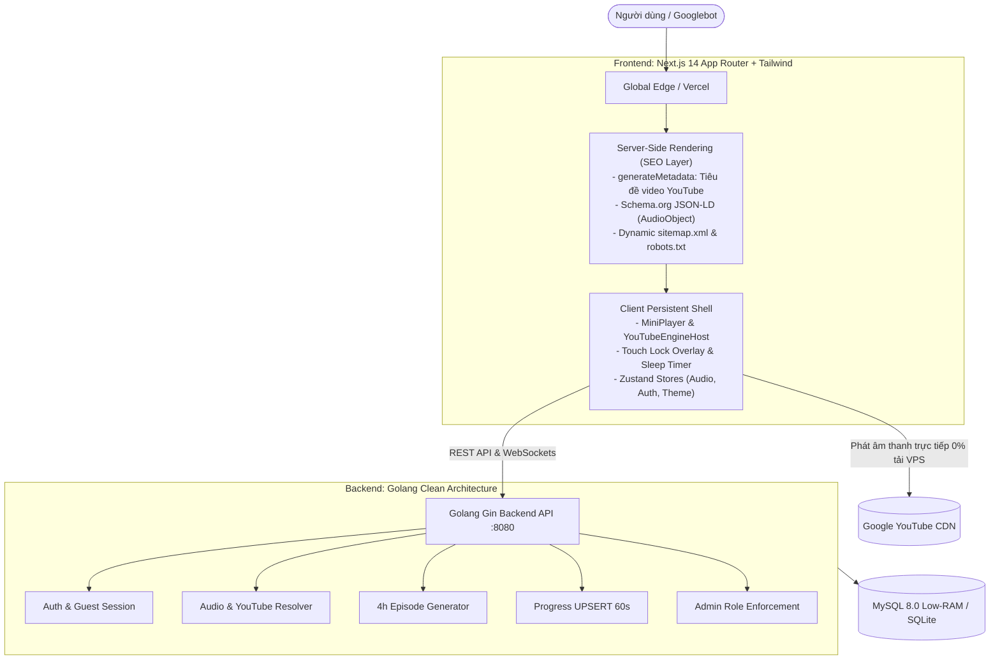
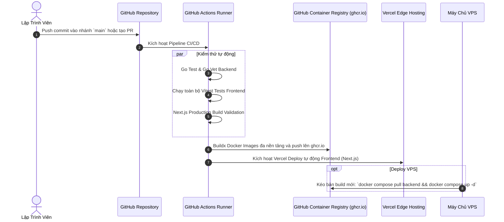

# 🎧 WAVELINK — NỀN TẢNG NGHE AUDIO TỪ YOUTUBE CHUẨN SEO
### Hệ Thống Nghe Truyện Audio, Podcast & Sách Nói Tắt Màn Hình — Zero Audio Hosting — Next.js App Router & Golang

<p align="center">
  
  
  
  
  
  
  
  
  
</p>

---

## 📖 MỤC LỤC

1. [Tổng Quan Về Dự Án (Project Overview)](#1-tổng-quan-về-dự-án-project-overview)
2. [Điểm Nhấn Tính Năng Chi Tiết (Feature Showcase)](#2-điểm-nhấn-tính-năng-chi-tiết-feature-showcase)
   - [2.1. Phát Nhạc & Podcast Chạy Ngầm Tắt Màn Hình (Mobile Background Audio)](#21-phát-nhạc--podcast-chạy-ngầm-tắt-màn-hình-mobile-background-audio)
   - [2.2. Khóa Màn Hình Tránh Chạm Nhầm (Full-Screen Touch-Lock Overlay)](#22-khóa-màn-hình-tránh-chạm-nhầm-full-screen-touch-lock-overlay)
   - [2.3. Tối Ưu Hóa SEO: Tìm Kiếm Video YouTube Trực Tiếp Trên Google](#23-tối-ưu-hóa-seo-tìm-kiếm-video-youtube-trực-tiếp-trên-google)
   - [2.4. Trình Phát MiniPlayer & Persistent Layout Không Bao Giờ Ngắt Quãng](#24-trình-phát-miniplayer--persistent-layout-không-bao-giờ-ngắt-quãng)
   - [2.5. Điều Phối Tốc Độ Phát Thông Minh (Ghi Nhớ x1.5 / x2.0 Xuyên Suốt)](#25-điều-phối-tốc-độ-phát-thông-minh-ghi-nhớ-x15--x20-xuyên-suốt)
   - [2.6. Tự Động Phân Tập Logic 4 Giờ (Smart Logical Episodes)](#26-tự-động-phân-tập-logic-4-giờ-smart-logical-episodes)
   - [2.7. Ghi Nhớ & Tự Động Tiếp Tục Nghe (Resume & Auto-Sync Progress)](#27-ghi-nhớ--tự-động-tiếp-tục-nghe-resume--auto-sync-progress)
   - [2.8. Hẹn Giờ Tắt Nhạc Êm Dịu (Sleep Timer Worker)](#28-hẹn-giờ-tắt-nhạc-êm-dịu-sleep-timer-worker)
   - [2.9. Nâng Cấp Gói VIP & Thanh Toán VietQR Tự Động](#29-nâng-cấp-gói-vip--thanh-toán-vietqr-tự-động)
   - [2.10. Cộng Đồng Thính Giả & Bảng Xếp Hạng Nghe](#210-cộng-đồng-thính-giả--bảng-xếp-hạng-nghe)
   - [2.11. Bảng Quản Trị Hệ Thống Toàn Diện & Bảo Vệ Quyền Hạn Nghiêm Ngặt](#211-bảng-quản-trị-hệ-thống-toàn-diện--bảo-vệ-quyền-hạn-nghiêm-ngặt)
3. [Kiến Trúc Kỹ Thuật Toàn Cảnh (Architecture)](#3-kiến-trúc-kỹ-thuật-toàn-cảnh-architecture)
4. [Hướng Dẫn Chạy Môi Trường Cục Bộ (Local Dev)](#4-hướng-dẫn-chạy-môi-trường-cục-bộ-local-dev)
5. [Hướng Dẫn Triển Khai Bằng Docker](#5-hướng-dẫn-triển-khai-bằng-docker)
6. [Quy Trình Tự Động Hóa CI/CD & Deploy Production](#6-quy-trình-tự-động-hóa-cicd--deploy-production)
7. [Cấu Trúc Thư Mục Toàn Dự Án](#7-cấu-trúc-thư-mục-toàn-dự-án)
8. [Danh Mục REST API & Tích Hợp](#8-danh-mục-rest-api--tích-hợp)

---

## 1. TỔNG QUAN VỀ DỰ ÁN (PROJECT OVERVIEW)

**WaveLink** là nền tảng web hiện đại chuyên biệt cho việc thưởng thức các bộ truyện audio, sách nói, podcast, talkshow và bài giảng dài tập từ YouTube mà **không cần mở sáng màn hình điện thoại** và **không cần lưu trữ file MP3 vật lý**.

> [!TIP]
> **Vấn đề cốt lõi WaveLink giải quyết:**  
> Trình phát YouTube thông thường sẽ dừng phát ngay khi người dùng tắt màn hình hoặc chuyển sang ứng dụng khác (trừ khi có YouTube Premium). Ngoài ra, các video truyện hay sách nói thường kéo dài từ 10 đến 30 tiếng liên tục rất khó nhớ mốc thời gian đã nghe dở.  
> **WaveLink biến mọi video YouTube thành một kho truyện audio chuyên nghiệp**, hỗ trợ phát ngầm khi tắt màn hình, điều khiển qua thanh thông báo/màn hình khóa, tự động chia tập và đồng bộ tiến trình nghe mọi lúc mọi nơi.

### Triết Lý Kỹ Thuật Cốt Lõi:
1. **Zero-Audio-Hosting (Tiết kiệm 100% chi phí lưu trữ âm thanh):**  
   Hệ thống không tải về, không lưu trữ và không chuyển đổi mã bất kỳ tệp MP3 nào lên server. Âm thanh được phát trực tiếp từ hạ tầng CDN toàn cầu của Google qua YouTube IFrame Engine ngầm. Máy chủ tiêu tốn **0% băng thông** và **0% CPU** cho streaming.
2. **Hybrid Next.js App Router (Chuẩn SEO & Phát Nhạc Liền Mạch):**  
   Ứng dụng sử dụng Next.js App Router với kiến trúc kết hợp: các trang chi tiết audio được Server-Side Render (SSR) đầy đủ Metadata và Schema.org để bot Google tìm kiếm dễ dàng, đồng thời bao bọc bởi Client Shell để âm thanh **không bao giờ bị gián đoạn khi người dùng chuyển trang**.

---

## 2. ĐIỂM NHẤN TÍNH NĂNG CHI TIẾT (FEATURE SHOWCASE)

```
┌────────────────────────────────────────────────────────────────────────┐
│                        TÍNH NĂNG NỔI BẬT WAVELINK                      │
├──────────────────────────┬──────────────────────────┬──────────────────┤
│ 🔋 Phát Nhạc Tắt Màn Hình│ 🔒 Khóa Tránh Chạm Nhầm  │ 🚀 SEO Chuẩn GG  │
│ 🎵 MiniPlayer Giữ Âm     │ ⚡ Nhớ Tốc Độ x1.5 / x2.0│ 📚 Chia Tập 4h   │
│ ⏱️ Hẹn Giờ Ngủ Tắt Dần   │ 💳 Thanh Toán VietQR VIP │ 🛡️ Admin Guard   │
└──────────────────────────┴──────────────────────────┴──────────────────┘
```

### 2.1. Phát Nhạc & Podcast Chạy Ngầm Tắt Màn Hình (Mobile Background Audio)
* **Khắc phục giới hạn di động:** Tích hợp `Silent Audio Context Keeper` và PWA Web App manifest, cho phép ứng dụng giữ kết nối âm thanh ổn định trên cả **Android Chrome** và **iOS Safari** ngay cả khi người dùng tắt màn hình hoặc chuyển sang lướt Facebook/Zalo/TikTok.
* **Tích hợp MediaSession API:** Hiển thị ảnh bìa sắc nét, tên bài hát, kênh tác giả và các nút điều khiển (`Phát/Dừng`, `Tua tới 10s`, `Tua lùi 10s`, `Chuyển tập`) ngay trên **Màn hình khóa (Lock Screen)** và trung tâm điều khiển của điện thoại.

### 2.2. Khóa Màn Hình Tránh Chạm Nhầm (Full-Screen Touch-Lock Overlay)
* **Trải nghiệm thực tế:** Khi đi bộ, tập gym, chạy xe hoặc nghe truyện trước khi ngủ, việc nhét điện thoại vào túi quần/áo rất dễ bị cọ xát gây nhảy sang bài khác hoặc chạm nhầm phím tua.
* **Giải pháp thông minh:** Nút khóa một chạm kích hoạt màn hình phủ mờ chống chạm (`ScreenLockOverlay`). Mọi thao tác vuốt chạm thông thường sẽ bị vô hiệu hóa an toàn. Người dùng chỉ cần nhấn giữ biểu tượng ổ khóa trong 1.5 giây để mở khóa trở lại.

### 2.3. Tối Ưu Hóa SEO: Tìm Kiếm Video YouTube Trực Tiếp Trên Google
* **Tìm kiếm chính xác:** Người dùng chỉ cần tìm kiếm bằng **chính tên video YouTube gốc** (ví dụ: *"Đắc Nhân Tâm audio full"*, *"Truyện Ma Người Khăn Trắng tập 1"*) trên Google Tìm kiếm là bot Google có thể đối chiếu và hiển thị trang nghe audio WaveLink tương ứng.
* **Dữ liệu có cấu trúc Rich Snippets (JSON-LD Schema.org):** Mỗi trang `/player/[id]` tự động sinh mã Schema:
  - `@type: "AudioObject"`: Khai báo tên, mô tả, link YouTube gốc, thời lượng chuẩn ISO 8601.
  - `@type: "MusicRecording"` / `"VideoObject"`: Giúp bot Google nhận diện thực thể âm thanh chính xác.
  - `@type: "BreadcrumbList"`: Hiển thị đường dẫn chuyên mục chuyên nghiệp trên kết quả tìm kiếm.
* **OpenGraph & Twitter Card sắc nét:** Tự động lấy ảnh thumbnail phân giải cao của YouTube (`maxresdefault.jpg` / `hqdefault.jpg`) để hiển thị thẻ xem trước khi chia sẻ link lên Facebook, Zalo, Telegram.
* **Sitemap & Robots tự động:** File `/sitemap.xml` tự động thu thập toàn bộ các audio YouTube đã được import và cung cấp cho Googlebot lập chỉ mục liên tục.

### 2.4. Trình Phát MiniPlayer & Persistent Layout Không Bao Giờ Ngắt Quãng
* **Layout bất biến:** Nhờ cơ chế Layout của Next.js App Router, toàn bộ App Shell bao gồm Header, Footer, `MiniPlayer` và `YouTubeEngineHost` được duy trì liên tục trên trình duyệt.
* **Chuyển trang tự do:** Bạn có thể vừa nghe sách nói, vừa chuyển sang xem danh mục Thư viện, đọc bảng tin Cộng đồng, chỉnh sửa Cài đặt hoặc tìm kiếm nội dung mới mà **tiếng nhạc/giọng đọc không bị ngắt một giây nào**.
* **MiniPlayer Neo-Brutalism:** Thanh phát nhạc thu nhỏ ở đáy màn hình hiển thị trực quan tiến trình phần trăm, nút Play/Pause nhanh, và hỗ trợ bấm để phóng to về trình phát chính bất kỳ lúc nào.

### 2.5. Điều Phối Tốc Độ Phát Thông Minh (Ghi Nhớ x1.5 / x2.0 Xuyên Suốt)
* **Giải quyết lỗi cố hữu của YouTube IFrame API:** Thông thường, IFrame API của YouTube luôn tự ý reset tốc độ nghe về `1.0x` mỗi khi chuyển tập hoặc tải bài mới.
* **Bộ điều phối độc quyền (`PlaybackRateCoordinator`):** Cơ chế khóa chủ đích (`Intent Lock`) trong Zustand Store tự động can thiệp và thiết lập lại chính xác tốc độ mà người dùng đã chọn (`0.75x`, `1.0x`, `1.25x`, `1.5x`, `1.75x`, `2.0x`) ngay khi tập mới bắt đầu phát. Tùy chọn này được ghi nhớ vĩnh viễn theo tài khoản.

### 2.6. Tự Động Phân Tập Logic 4 Giờ (Smart Logical Episodes)
* **Xử lý video siêu dài:** Các video tổng hợp trên YouTube thường kéo dài từ 8 đến hơn 30 tiếng liên tục. Người dùng rất khó theo dõi tiến trình hoặc tìm lại đoạn đang nghe dở.
* **Thuật toán phân đoạn tự động:** Khi import link YouTube, Backend tự động tính toán thời lượng và chia nhỏ video thành các tập 4 giờ (`14400 giây/tập`) dựa trên toạ độ mốc giây (`start_seconds` và `end_seconds`), giúp danh sách tập gọn gàng, trực quan và dễ quản lý.

### 2.7. Ghi Nhớ & Tự Động Tiếp Tục Nghe (Resume & Auto-Sync Progress)
* **Đồng bộ ngầm định kỳ:** Tiến trình nghe được tự động lưu mỗi 60 giây và lưu ngay lập tức khi người dùng bấm Pause hoặc đóng tab.
* **Hỗ trợ Khách Vãng Lai (Guest Session):** Người dùng không bắt buộc phải đăng nhập tài khoản. Chế độ Khách lưu trữ tiến trình cục bộ thông qua SessionStorage/LocalDB, cho phép bấm nghe lại đúng giây nghe dở hôm trước. Khi đăng nhập tài khoản, tiến trình khách sẽ được hợp nhất an toàn.

### 2.8. Hẹn Giờ Tắt Nhạc Êm Dịu (Sleep Timer Worker)
* **Chuyên dụng cho giấc ngủ:** Tích hợp bộ hẹn giờ đa dạng: `15 phút`, `30 phút`, `45 phút`, `60 phút`, hoặc `Khi hết tập hiện tại`.
* **Giảm âm lượng êm dịu (Audio Fade-out):** Khi sắp hết thời gian hẹn, âm thanh sẽ tự động hạ dần âm lượng trong 30 giây cuối cùng thay vì tắt đột ngột, giúp người dùng chìm vào giấc ngủ tự nhiên mà không bị giật mình.

### 2.9. Nâng Cấp Gói VIP & Thanh Toán VietQR Tự Động
* **Quyền lợi VIP:** Mở khóa giới hạn lượt import link YouTube mỗi ngày, truy cập các bộ audio VIP độc quyền và huy hiệu VIP sáng bóng trên trang cá nhân.
* **Thanh toán VietQR chuẩn Napas:** Tự động tạo mã QR ngân hàng kèm số tài khoản, số tiền và nội dung chuyển khoản mã hóa. Khi quét mã trên ứng dụng ngân hàng, người dùng không cần gõ tay bất kỳ thông tin nào.

### 2.10. Cộng Đồng Thính Giả & Bảng Xếp Hạng Nghe
* **Chia sẻ cảm nghĩ:** Người dùng có thể chia sẻ câu chuyện, đoạn trích yêu thích hoặc review các bộ sách nói cho cộng đồng cùng thảo luận.
* **Bảng vàng thính giả:** Hệ thống tính toán tổng số giờ nghe thực tế và xếp hạng những thính giả chăm chỉ nhất theo tuần/tháng.

### 2.11. Bảng Quản Trị Hệ Thống Toàn Diện & Bảo Vệ Quyền Hạn Nghiêm Ngặt
* **Dashboard trực quan:** Bảng điều khiển quản lý toàn bộ hệ thống gồm thống kê tổng số giờ nghe, quản lý kho Audio, phân tập Episode, danh mục Thể loại, tài khoản người dùng và duyệt gói VIP.
* **Bảo vệ độc quyền bằng `AdminGuard`:** Toàn bộ khu vực `/admin/*` được bảo vệ tuyệt đối. Bất kỳ tài khoản thông thường hoặc khách cố tình truy cập vào URL quản trị sẽ bị chặn hoàn toàn cuộc gọi API, nhận thông báo Toast cảnh báo tức thì và màn hình thông báo chuẩn Comic: **`Permission Denied: Không thể truy cập`**.

---

## 3. KIẾN TRÚC KỸ THUẬT TOÀN CẢNH (ARCHITECTURE)

Hệ thống kết hợp sức mạnh giữa **Next.js App Router (Frontend Hybrid)** và **Golang Gin (Backend Tốc Độ Cao)**:



---

## 4. HƯỚNG DẪN CHẠY MÔI TRƯỜNG CỤC BỘ (LOCAL DEV)

### Yêu Cầu Cài Đặt Sẵn:
- **Node.js**: Phiên bản `20.x` hoặc `22.x` (khuyên dùng Node 22).
- **Go**: Phiên bản `1.22+` hoặc `1.26`.

### Cách 1: Khởi Chạy 1-Click Bằng Launcher GUI (Khuyên Dùng Cho Windows)
Thư mục `start/` cung cấp sẵn bảng điều khiển web tiện lợi:

```powershell
# Chạy script khởi động từ thư mục gốc:
.\start\start.bat
```
* Bảng điều khiển Web GUI: `http://localhost:9999`
* Ứng dụng Frontend (Next.js): `http://localhost:3000` (hoặc `http://localhost:5173` khi chạy Vite)
* Backend API: `http://localhost:8080/health`
* Lệnh tắt toàn bộ dịch vụ nhanh: `.\start\start.bat --stop`

---

### Cách 2: Chạy Thủ Công Từng Service

#### Bước 1: Khởi động Backend (Golang + SQLite)
```bash
cd backend
cp .env.example .env
go run ./cmd/api/main.go
```
*(Tùy chọn) Chạy seed tài khoản quản trị và dữ liệu audio mẫu:*
```bash
go run ./cmd/seed/main.go
```
> **Tài khoản Admin mặc định:**  
> - **Username:** `admin123`  
> - **Password:** `admin123`  
> - **Role:** `ADMIN`

#### Bước 2: Khởi động Frontend (Next.js App Router)
Mở cửa sổ Terminal thứ 2:
```bash
cd frontend
npm install
npm run dev
```
Trình duyệt sẽ mở tại `http://localhost:3000`.

---

## 5. HƯỚNG DẪN TRIỂN KHAI BẰNG DOCKER

Dự án cung cấp cấu hình `docker-compose.yml` hợp nhất chạy được trên cả môi trường Dev cục bộ lẫn máy chủ VPS sản xuất.

### 1. Chạy Fullstack Bằng Docker Compose (Cục Bộ)
```bash
# 1. Tạo file cấu hình từ mẫu dev:
cp env.dev.example env.dev

# 2. Khởi động toàn bộ container:
docker compose --env-file env.dev up -d

# 3. Xem nhật ký log hoạt động:
docker compose --env-file env.dev logs -f
```

### 2. Chạy Trên VPS Ubuntu (Chế Độ 2-Containers Tiết Kiệm RAM)
Trên các gói VPS nhỏ (1GB - 2GB RAM), mô hình tối ưu nhất là đặt Frontend trên Vercel (miễn phí băng thông) và chạy **đúng 2 container** (`backend` + `mysql-low-memory`) trên VPS:

```bash
# 1. Clone repository về VPS:
git clone https://github.com/TranDucAnh3103/wavelink-audio-app.git
cd wavelink-audio-app

# 2. Chạy script cài đặt 1-click tự động:
chmod +x deploy/ubuntu-deploy.sh
./deploy/ubuntu-deploy.sh
```

**Script tự động thực hiện các tối ưu hạ tầng:**
- Tạo **2GB Swapfile** chống tràn RAM (OOM Killer).
- Nạp cấu hình MySQL Low-Memory (`deploy/mysql/my-low-memory.cnf`), giảm RAM MySQL từ 550MB xuống chỉ còn **~160MB**.
- Tự động kéo image từ GitHub Container Registry (`ghcr.io`), không tốn CPU/RAM để biên dịch trên VPS.

---

## 6. QUY TRÌNH TỰ ĐỘNG HÓA CI/CD & DEPLOY PRODUCTION

Pipeline [`.github/workflows/docker-ci.yml`](file:///.github/workflows/docker-ci.yml) tự động hóa 100% quy trình từ kiểm thử đến phát hành sản phẩm:



### Triển khai Frontend lên Vercel:
Tệp [`vercel.json`](file:///f:/Build/wavelink-audio-app/vercel.json) ở thư mục gốc đã được thiết lập sẵn cho Next.js App Router:
- Import repository vào [Vercel](https://vercel.com).
- Cấu hình biến môi trường trên Vercel:
  ```bash
  NEXT_PUBLIC_API_BASE_URL=https://api.yourdomain.com/api/v1
  NEXT_PUBLIC_SITE_URL=https://your-domain.vercel.app
  ```

---

## 7. CẤU TRÚC THƯ MỤC TOÀN DỰ ÁN

```
wavelink-audio-app/
├── .github/
│   └── workflows/
│       └── docker-ci.yml           # CI/CD pipeline tự động hóa (Test, Docker Build, Publish)
├── backend/                        # Mã nguồn Golang Clean Architecture API
│   ├── cmd/
│   │   ├── api/main.go             # Entrypoint máy chủ Gin API
│   │   └── seed/main.go            # Tool khởi tạo dữ liệu mẫu
│   ├── config/                     # Quản lý biến môi trường
│   ├── core/                       # Interfaces, middleware, cấu trúc envelope chuẩn
│   ├── infra/                      # Kết nối MySQL/SQLite, logger
│   ├── modules/                    # Các module nghiệp vụ độc lập:
│   │   ├── audio/                  # Quản lý Audio & YouTube oEmbed
│   │   ├── auth/                   # JWT, Guest Session, phân quyền
│   │   ├── episode/                # Phân tập tự động 4 giờ
│   │   ├── progress/               # Đồng bộ tiến trình nghe (UPSERT)
│   │   └── membership/             # Quản lý gói VIP & VietQR
│   ├── Dockerfile                  # Multi-stage Dockerfile cho Golang Alpine (<25MB)
│   └── go.mod / go.sum
├── frontend/                       # Mã nguồn Next.js App Router Frontend
│   ├── src/
│   │   ├── app/                    # Next.js 14 App Router Directory
│   │   │   ├── layout.tsx          # Root Layout (Metadata, Fonts, PWA, Providers)
│   │   │   ├── client-shell.tsx    # Persistent Player Layout (Giữ âm thanh liên tục)
│   │   │   ├── page.tsx            # Trang chủ với Schema.org WebSite
│   │   │   ├── player/[id]/        # Trang phát chi tiết (SEO YouTube Title & AudioObject Schema)
│   │   │   ├── admin/[[...slug]]/  # Khu vực Admin (Bọc bởi AdminGuard nghiêm ngặt)
│   │   │   ├── sitemap.ts          # Tự động sinh sitemap.xml động
│   │   │   └── robots.ts           # Cấu hình chỉ mục robots.txt
│   │   ├── components/             # Reusable UI Components (Player, MiniPlayer, Header, Modal)
│   │   ├── lib/
│   │   │   ├── routerCompat.tsx    # Cầu nối tương thích React Router DOM -> Next.js
│   │   │   ├── serverAudio.ts      # Helper lấy dữ liệu SSR cho Metadata SEO
│   │   │   ├── backgroundAudioKeeper.ts # Trình giữ âm thanh nền trên di động
│   │   │   └── playbackRateCoordinator.ts # Bộ nhớ tốc độ phát x1.5 / x2.0
│   │   ├── stores/                 # Zustand Stores (playerStore, authStore, themeStore)
│   │   ├── views/                  # Toàn bộ View Components gốc (HomePage, PlayerPage, Admin...)
│   │   └── test/                   # Bộ kiểm thử tự động Vitest
│   ├── next.config.mjs             # Cấu hình Next.js (Webpack alias, Image remote patterns)
│   ├── package.json
│   └── tsconfig.json
├── deploy/                         # Công cụ và script triển khai production
│   ├── mysql/my-low-memory.cnf     # Cấu hình MySQL 8 tối ưu RAM cho VPS
│   └── ubuntu-deploy.sh            # Script cài đặt 1-click trên Ubuntu VPS
├── start/                          # Bộ công cụ Launcher GUI cục bộ (Python + Batch)
├── docker-compose.yml              # File Compose điều phối đa container
├── vercel.json                     # Cấu hình deploy Next.js trên Vercel Edge
└── README.md                       # Tài liệu hướng dẫn toàn diện dự án
```

---

## 8. DANH MỤC REST API & TÍCH HỢP

Tất cả các API được chuẩn hóa dưới tiền tố `/api/v1`:

| Method | Endpoint | Quyền hạn | Mô tả chức năng |
| :--- | :--- | :---: | :--- |
| `POST` | `/api/v1/audios/import-youtube` | User / Admin | Nhập link video YouTube, kiểm tra hợp lệ và sinh các tập 4h. |
| `GET` | `/api/v1/audios` | Public | Danh sách Audio thư viện (hỗ trợ phân trang, lọc thể loại, tìm kiếm). |
| `GET` | `/api/v1/audios/:id` | Public | Xem thông tin chi tiết Audio & danh sách tập logic. |
| `GET` | `/api/v1/audios/:id/episodes` | Public | Lấy tọa độ giây `start_seconds` và `end_seconds` từng tập. |
| `GET` | `/api/v1/audios/:id/progress` | Auth / Guest | Lấy mốc giây đã nghe gần nhất để Resume trình phát. |
| `PUT` | `/api/v1/progress` | Auth / Guest | Lưu tiến trình nghe (gọi định kỳ mỗi 60s hoặc khi Pause). |
| `GET` | `/api/v1/categories` | Public | Danh sách các thể loại truyện audio. |
| `GET` | `/api/v1/memberships/plans` | Public | Danh sách gói hội viên VIP và bảng giá. |
| `POST` | `/api/v1/memberships/subscribe` | Auth | Tạo đơn đăng ký VIP kèm mã quét VietQR tự động. |
| `GET` | `/api/v1/community/messages` | Public | Danh sách tin nhắn & thảo luận trong cộng đồng. |
| `GET` | `/health` | Public | Healthcheck kiểm tra sức khỏe hệ thống (cho Docker & Nginx). |

---

<p align="center">
  <b>WaveLink — Nghe Mọi Lúc, Trải Nghiệm Mọi Nơi</b><br/>
  <i>Được thiết kế và tối ưu hóa vì trải nghiệm thính giả tốt nhất © 2026.</i>
</p>
