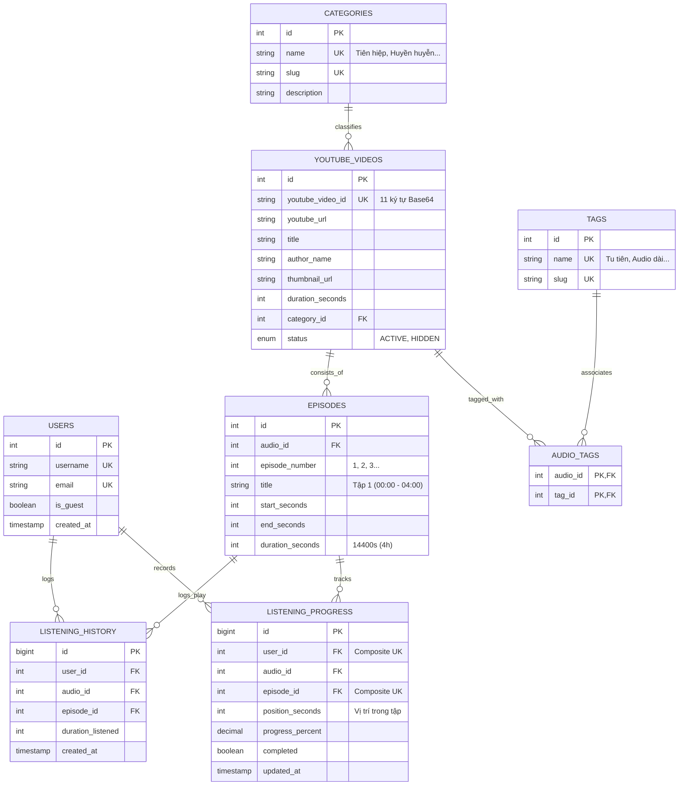
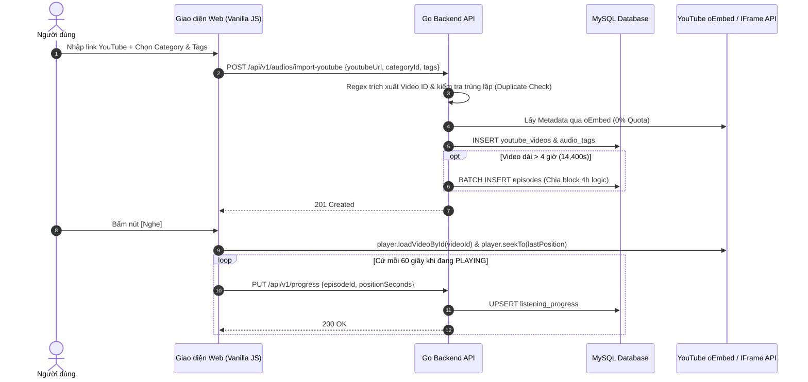

# YOUTUBE AUDIO LIBRARY — HƯỚNG DẪN KIẾN TRÚC & BẢO TRÌ TỐI GIẢN
## Bộ Tài Liệu Tinh Gọn Cho Kỹ Sư Phát Triển & Vận Hành (Low-Resource Environment)

> **Mục tiêu hệ thống:** Chuyển đổi mọi liên kết YouTube thành Audio Item trong Thư viện, hỗ trợ Thể loại (Category), Thẻ gắn (Tags), Phân đoạn tập logic (4h/tập) cho video siêu dài (> 24h), Tìm kiếm / Lọc đa tiêu chí, Phát âm thanh qua YouTube IFrame Player API và Đồng bộ tiến trình nghe (Listening Progress) mỗi 60 giây.  
> **Môi trường vận hành:** Linux VPS chi phí thấp (1 vCPU, 1GB RAM, SSD hạn chế, không GPU).  
> **Nguyên tắc kỹ thuật tối cao:**  
> `Correctness > Legal & Policy Compliance > Security > Low Resource Usage > Simplicity > Maintainability > Performance`

---

## 1. BỘ TÀI LIỆU TRỌNG TÂM (ĐỊNH DẠNG MARKDOWN)

Thư mục chính [`docs/`](file:///c:/Users/trand/Downloads/Audio-app-vanila/docs) lưu trữ các tài liệu kiến trúc chuẩn hóa định dạng Markdown:

| STT | File Tài Liệu (.md) | Nội Dung Trọng Tâm & Phạm Vi Duy Trì |
|:---:|:---|:---|
| **01** | [01_HE_THONG_VA_KIEN_TRUC_TONG_THE.md](file:///c:/Users/trand/Downloads/Audio-app-vanila/docs/01_HE_THONG_VA_KIEN_TRUC_TONG_THE.md) | **Kiến trúc tổng thể & Nguyên lý bất biến:** Định vị hệ thống, topology tách biệt Frontend/Backend, bảng phân bổ ngân sách RAM VPS 1GB và quyết định kỹ thuật cốt lõi (ADRs). |
| **02** | [02_CSDL_MYSQL_VA_DONG_BO_TIEN_TRINH.md](file:///c:/Users/trand/Downloads/Audio-app-vanila/docs/02_CSDL_MYSQL_VA_DONG_BO_TIEN_TRINH.md) | **Database & Tiến trình:** Mã nguồn DDL 8 bảng chuẩn hóa (3NF), ERD, thuật toán sinh Logical Episode (khối 4h) cho video > 24h, cơ chế UPSERT progress 60s và xử lý ngoại tuyến. |
| **03** | [03_DAC_TA_REST_API_VA_XU_LY_YOUTUBE.md](file:///c:/Users/trand/Downloads/Audio-app-vanila/docs/03_DAC_TA_REST_API_VA_XU_LY_YOUTUBE.md) | **API & Tích hợp YouTube:** Đặc tả 13 REST API endpoints v1 chuẩn hóa, Regex khử độc URL chống SSRF, cơ chế oEmbed 0% quota và tích hợp YouTube IFrame Player API. |
| **04** | [04_TRIEN_KHAI_BAO_MAT_VA_VAN_HANH.md](file:///c:/Users/trand/Downloads/Audio-app-vanila/docs/04_TRIEN_KHAI_BAO_MAT_VA_VAN_HANH.md) | **Triển khai & Vận hành:** Cấu hình Nginx reverse proxy, Rate limiting, SSL Let's Encrypt, file cấu hình systemd khống chế RAM, kịch bản cron backup. |
| **05** | [kiemdinh01.md](file:///c:/Users/trand/Downloads/Audio-app-vanila/docs/kiemdinh01.md) | **Báo cáo kiểm định kiến trúc & 14 bản vá Backend:** Triệt tiêu N+1 query, bảo vệ RAM, SQLite WAL, Rate limiting. |

---

## 2. NGUYÊN TẮC BẤT BIẾN DÀNH CHO BẢO TRÌ (CORE RULES)

1. **KHÔNG TẢI VỀ HAY LƯU FILE MP3 TỪ YOUTUBE:**
   * Hệ thống chỉ lưu **Metadata** (Title, Channel, Duration, Thumbnail) và **Mốc thời gian** (start/end seconds).
   * Âm thanh được truyền phát trực tiếp từ hạ tầng Google CDN thông qua **YouTube IFrame Player API** (0% tải CPU và 0% băng thông cho server backend).
2. **PHÂN ĐOẠN TẬP LOGIC (LOGICAL EPISODES 4H):**
   * Video dài 20–30 giờ được chia thành các tập 4 giờ (`start_seconds`, `end_seconds`) trong database.
   * Tuyệt đối không cắt file âm thanh vật lý hay nhân bản file trên đĩa cứng.
3. **TIẾN TRÌNH 60 GIÂY & LỊCH SỬ:**
   * Bảng `listening_progress`: Cập nhật mỗi 60 giây khi nghe dở (`UPSERT` duy nhất 1 bản ghi/tập).
   * Bảng `listening_history`: Ghi nhận nhật ký nghe khi người dùng hoàn thành hoặc nghe trên 30 giây (`APPEND-ONLY`).

---

## 3. MÔ HÌNH THỰC THỂ DỮ LIỆU MYSQL (DATABASE ERD)

---

## 4. QUY TRÌNH IMPORT & ĐỒNG BỘ TIẾN TRÌNH

---

## 5. DANH MỤC 13 API ENDPOINTS CẦN DUY TRÌ

1. `POST /api/v1/audios/import-youtube`: Import link YouTube, lấy metadata, sinh episode.
2. `GET /api/v1/audios`: Lấy danh sách thư viện (phân trang, lọc theo Category/Tag/Author).
3. `GET /api/v1/audios/{id}`: Xem chi tiết Audio.
4. `PUT /api/v1/audios/{id}`: Cập nhật Category, Tags, mô tả.
5. `POST /api/v1/audios/{id}/refresh`: Đồng bộ lại metadata từ YouTube oEmbed.
6. `GET /api/v1/audios/{id}/episodes`: Lấy danh sách các tập logic.
7. `POST /api/v1/audios/{id}/episodes/generate`: Tạo lại tập theo cấu hình thời gian mới.
8. `GET /api/v1/categories`: Lấy danh mục thể loại (In-memory cached).
9. `GET /api/v1/tags`: Lấy danh sách tags phổ biến.
10. `GET /api/v1/users/me/progress`: Lấy danh sách audio đang nghe dở của người dùng.
11. `GET /api/v1/audios/{id}/progress`: Lấy vị trí Resume của bài nghe.
12. `PUT /api/v1/progress`: Cập nhật tiến trình nghe (định kỳ 60s hoặc khi pause/seek).
13. `POST /api/v1/history`: Ghi nhận nhật ký nghe hoàn thành.
