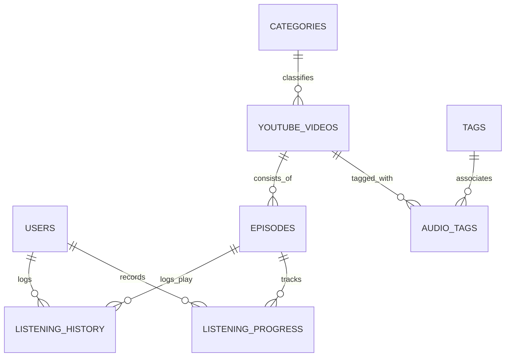

# 02. CƠ SỞ DỮ LIỆU & ĐỒNG BỘ TIẾN TRÌNH
### Thiết Kế Schema, Logical Episodes & Thuật Toán Progress 60s

---

## 1. Sơ Đồ Thực Thể Quan Hệ (Entity Relationship Model)

Hệ thống chuẩn hóa trên 8 bảng thực thể tinh gọn (3NF).
- Mối quan hệ giữa Audio và Tags là Many-to-Many qua `audio_tags`.
- Mối quan hệ giữa Audio và Episodes là One-to-Many với ràng buộc duy nhất (`audio_id`, `episode_number`).



---

## 2. Mã Nguồn DDL Chuẩn Hóa

```sql
-- 1. Bảng Người dùng & Guest identity
CREATE TABLE IF NOT EXISTS users (
    id INT UNSIGNED AUTO_INCREMENT PRIMARY KEY,
    username VARCHAR(50) NOT NULL UNIQUE,
    email VARCHAR(100) NULL UNIQUE,
    password_hash VARCHAR(255) NULL,
    is_guest BOOLEAN NOT NULL DEFAULT FALSE,
    created_at TIMESTAMP DEFAULT CURRENT_TIMESTAMP,
    updated_at TIMESTAMP DEFAULT CURRENT_TIMESTAMP ON UPDATE CURRENT_TIMESTAMP
) ENGINE=InnoDB DEFAULT CHARSET=utf8mb4 COLLATE=utf8mb4_0900_ai_ci;

-- 2. Bảng Thể loại (Categories: Tiên hiệp, Huyền huyễn, Podcast...)
CREATE TABLE IF NOT EXISTS categories (
    id INT UNSIGNED AUTO_INCREMENT PRIMARY KEY,
    name VARCHAR(100) NOT NULL UNIQUE,
    slug VARCHAR(100) NOT NULL UNIQUE,
    description VARCHAR(255) NULL,
    created_at TIMESTAMP DEFAULT CURRENT_TIMESTAMP
) ENGINE=InnoDB DEFAULT CHARSET=utf8mb4;

-- 3. Bảng Thẻ (Tags: Tu tiên, Truyện dài...)
CREATE TABLE IF NOT EXISTS tags (
    id INT UNSIGNED AUTO_INCREMENT PRIMARY KEY,
    name VARCHAR(50) NOT NULL UNIQUE,
    slug VARCHAR(50) NOT NULL UNIQUE,
    created_at TIMESTAMP DEFAULT CURRENT_TIMESTAMP
) ENGINE=InnoDB DEFAULT CHARSET=utf8mb4;

-- 4. Bảng Audio chính (YouTube Videos Metadata)
CREATE TABLE IF NOT EXISTS youtube_videos (
    id INT UNSIGNED AUTO_INCREMENT PRIMARY KEY,
    youtube_video_id VARCHAR(20) NOT NULL UNIQUE,
    youtube_url VARCHAR(500) NOT NULL,
    title VARCHAR(255) NOT NULL,
    description TEXT NULL,
    author_name VARCHAR(150) NULL,
    channel_id VARCHAR(100) NULL,
    thumbnail_url VARCHAR(500) NULL,
    duration_seconds INT UNSIGNED NOT NULL DEFAULT 0,
    category_id INT UNSIGNED NULL,
    published_at TIMESTAMP NULL,
    status ENUM('ACTIVE', 'HIDDEN', 'DELETED') DEFAULT 'ACTIVE',
    created_at TIMESTAMP DEFAULT CURRENT_TIMESTAMP,
    updated_at TIMESTAMP DEFAULT CURRENT_TIMESTAMP ON UPDATE CURRENT_TIMESTAMP,
    FULLTEXT INDEX idx_ft_title_author (title, author_name),
    INDEX idx_category (category_id),
    CONSTRAINT fk_videos_category FOREIGN KEY (category_id) REFERENCES categories (id) ON DELETE SET NULL
) ENGINE=InnoDB DEFAULT CHARSET=utf8mb4 COLLATE=utf8mb4_0900_ai_ci;

-- 5. Bảng liên kết Many-to-Many: audio_tags
CREATE TABLE IF NOT EXISTS audio_tags (
    audio_id INT UNSIGNED NOT NULL,
    tag_id INT UNSIGNED NOT NULL,
    PRIMARY KEY (audio_id, tag_id),
    INDEX idx_tag (tag_id),
    CONSTRAINT fk_at_audio FOREIGN KEY (audio_id) REFERENCES youtube_videos (id) ON DELETE CASCADE,
    CONSTRAINT fk_at_tag FOREIGN KEY (tag_id) REFERENCES tags (id) ON DELETE CASCADE
) ENGINE=InnoDB DEFAULT CHARSET=utf8mb4;

-- 6. Bảng Phân đoạn tập (Logical Episodes)
CREATE TABLE IF NOT EXISTS episodes (
    id INT UNSIGNED AUTO_INCREMENT PRIMARY KEY,
    audio_id INT UNSIGNED NOT NULL,
    episode_number INT UNSIGNED NOT NULL,
    title VARCHAR(200) NOT NULL,
    start_seconds INT UNSIGNED NOT NULL DEFAULT 0,
    end_seconds INT UNSIGNED NOT NULL,
    duration_seconds INT UNSIGNED NOT NULL,
    created_at TIMESTAMP DEFAULT CURRENT_TIMESTAMP,
    updated_at TIMESTAMP DEFAULT CURRENT_TIMESTAMP ON UPDATE CURRENT_TIMESTAMP,
    UNIQUE KEY uk_audio_episode (audio_id, episode_number),
    CONSTRAINT fk_episodes_audio FOREIGN KEY (audio_id) REFERENCES youtube_videos (id) ON DELETE CASCADE
) ENGINE=InnoDB DEFAULT CHARSET=utf8mb4;

-- 7. Bảng Tiến trình nghe (Listening Progress - UPSERT độc quyền)
CREATE TABLE IF NOT EXISTS listening_progress (
    id BIGINT UNSIGNED AUTO_INCREMENT PRIMARY KEY,
    user_id INT UNSIGNED NOT NULL,
    audio_id INT UNSIGNED NOT NULL,
    episode_id INT UNSIGNED NOT NULL,
    position_seconds INT UNSIGNED NOT NULL DEFAULT 0,
    duration_seconds INT UNSIGNED NOT NULL DEFAULT 0,
    progress_percent DECIMAL(5,2) NOT NULL DEFAULT 0.00,
    completed BOOLEAN NOT NULL DEFAULT FALSE,
    updated_at TIMESTAMP DEFAULT CURRENT_TIMESTAMP ON UPDATE CURRENT_TIMESTAMP,
    UNIQUE KEY uk_user_episode (user_id, episode_id),
    INDEX idx_user_audio (user_id, audio_id),
    CONSTRAINT fk_lp_audio FOREIGN KEY (audio_id) REFERENCES youtube_videos (id) ON DELETE CASCADE,
    CONSTRAINT fk_lp_episode FOREIGN KEY (episode_id) REFERENCES episodes (id) ON DELETE CASCADE
) ENGINE=InnoDB DEFAULT CHARSET=utf8mb4;

-- 8. Bảng Lịch sử nghe (Listening History - Append-only log)
CREATE TABLE IF NOT EXISTS listening_history (
    id BIGINT UNSIGNED AUTO_INCREMENT PRIMARY KEY,
    user_id INT UNSIGNED NOT NULL,
    audio_id INT UNSIGNED NOT NULL,
    episode_id INT UNSIGNED NOT NULL,
    started_at TIMESTAMP DEFAULT CURRENT_TIMESTAMP,
    ended_at TIMESTAMP NULL,
    duration_listened INT UNSIGNED NOT NULL DEFAULT 0,
    created_at TIMESTAMP DEFAULT CURRENT_TIMESTAMP,
    INDEX idx_user_history (user_id, created_at),
    CONSTRAINT fk_lh_audio FOREIGN KEY (audio_id) REFERENCES youtube_videos (id) ON DELETE CASCADE,
    CONSTRAINT fk_lh_episode FOREIGN KEY (episode_id) REFERENCES episodes (id) ON DELETE CASCADE
) ENGINE=InnoDB DEFAULT CHARSET=utf8mb4;
```

---

## 3. Cơ Chế Đồng Bộ Tiến Trình 60 Giây & Resume Thông Minh

* **Chu kỳ 60 giây:** Khi trạng thái là PLAYING, JavaScript Client kích hoạt timer mỗi 60 giây gửi `PUT /api/v1/progress`.
* **Sự kiện tức thời:** Ngay khi người dùng nhấn PAUSE, kết thúc bài (ENDED), tua nhạc (SEEK) hoặc chuyển tab (`visibilitychange`), client gửi ngay tiến trình.
* **Thuật toán UPSERT:** Đảm bảo mỗi cặp (`user_id`, `episode_id`) chỉ có DUY NHẤT 1 bản ghi, không bao giờ làm phình to database.
* **Khôi phục ngoại tuyến:** Nếu mất mạng, ghi tạm vị trí vào `localStorage` và tự động đồng bộ bù khi sự kiện `window.online` kích hoạt.
