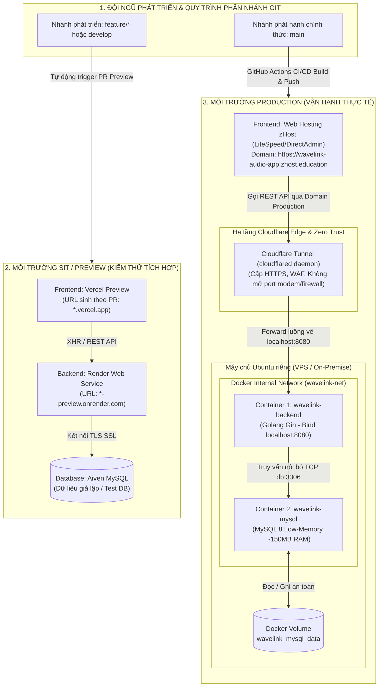

# 06. KẾ HOẠCH CHUYỂN ĐỔI HẠ TẦNG: PRODUCTION (HOSTING + UBUNTU SERVER TUNNEL) & SIT (VERCEL PREVIEW + RENDER PREVIEW)
### Dự án: WaveLink Audio App (React Vite + Golang Gin + MySQL 8.0)
**Tài liệu:** `docs/06_KE_HOACH_CHUYEN_DOI_HA_TANG_PROD_SIT_TUNNEL.md`  
**Ngày lập kế hoạch:** 21/10/2026  
**Trạng thái:** Kế hoạch kiến trúc & Hướng dẫn triển khai chi tiết  

---

## 1. TỔNG QUAN & MỤC TIÊU CHUYỂN ĐỔI

Hệ thống WaveLink Audio App đang trong quá trình chuẩn hóa hạ tầng vận hành nhằm tối ưu hóa chi phí, bảo mật máy chủ nội bộ và phân tách rõ ràng giữa môi trường kiểm thử (SIT / Preview) và môi trường vận hành thực tế (Production).

### 1.1. So sánh hiện trạng và mô hình đích

| Hạng mục | Hiện trạng ban đầu | Mô hình mục tiêu mới (Target) |
| :--- | :--- | :--- |
| **Frontend Production** | Vercel (`*.vercel.app`) kết hợp Hosting | **Web Hosting (zHost / DirectAdmin)** phục vụ tên miền chính thức `wavelink-audio-app.zhost.education`. |
| **Backend Production** | Render Cloud (`*.onrender.com`) | **Ubuntu Server riêng** (Dedicated VPS/Server) chạy Docker Backend + MySQL, kết nối an toàn qua **Cloudflare Tunnel**. |
| **Frontend Preview / SIT** | Vercel đồng thời chạy cả Prod lẫn Preview | **Vercel Preview**: Chỉ dùng để preview cho các Pull Request và nhánh phát triển (`develop`, `feature/*`). |
| **Backend Preview / SIT** | Render đóng vai trò backend chính | **Render Preview**: Đóng vai trò backend thử nghiệm cho môi trường SIT và PR preview. |
| **Kênh kết nối Backend Prod** | Public Internet qua Render CDN | **Cloudflare Tunnel** (Mã hóa SSL 2 chiều, chống DDoS, ẩn hoàn toàn IP gốc máy chủ VPS). |

---

## 2. KIẾN TRÚC HỆ THỐNG MỤC TIÊU (TARGET ARCHITECTURE)



---

## 3. PHÂN ĐỊNH VAI TRÒ CÁC NỀN TẢNG CÔNG NGHỆ

### 3.1. Vercel — Chỉ dành cho Preview
- **Nhiệm vụ:** Tự động bắt sự kiện từ GitHub khi có Pull Request hoặc push commit vào nhánh làm việc (`develop`, `feature/*`).
- **Ưu điểm:** Cung cấp đường link preview riêng biệt cho từng bản build, tích hợp sẵn bình luận (Vercel Comments) phục vụ kiểm định giao diện và tính năng.
- **Cấu hình:** Độc lập với domain production; biến môi trường `VITE_API_BASE_URL` trên Vercel Preview trỏ về Render Backend Preview.

### 3.2. Render — Chỉ dành cho Preview
- **Nhiệm vụ:** Cung cấp Backend API cho môi trường kiểm thử (SIT).
- **Cấu hình:** Web Service trên Render gắn với nhánh `develop` hoặc bật tính năng **Pull Request Preview Environments**.
- **CORS:** Cấu hình `ALLOWED_ORIGINS=https://*.vercel.app,http://localhost:5173` để chấp nhận mọi domain preview từ Vercel.

### 3.3. Web Hosting (zHost / DirectAdmin) — Deploy Frontend Production
- **Nhiệm vụ:** Đăng cai toàn bộ mã nguồn tĩnh (HTML, CSS, JS, Assets) của ứng dụng web phục vụ người dùng cuối.
- **Domain:** `https://wavelink-audio-app.zhost.education`.
- **Cơ chế triển khai:** GitHub Actions tự động build bản phát hành (với URL API Production) và đẩy file tĩnh qua FTP vào thư mục `public_html/`.
- **Điều hướng SPA:** File `.htaccess` điều hướng toàn bộ request không trùng file vật lý về `index.html` của React.

### 3.4. Ubuntu Server riêng — Deploy Backend & Database Production
- **Nhiệm vụ:** Xử lý toàn bộ logic nghiệp vụ, xác thực JWT, stream audio YouTube metadata và lưu trữ dữ liệu MySQL bền vững.
- **Tối ưu tài nguyên:** Áp dụng mô hình **2 Containers tối ưu**:
  - `wavelink-backend`: ~30MB - 50MB RAM.
  - `wavelink-mysql`: Tối ưu Low-Memory `--performance-schema=OFF`, `innodb_buffer_pool_size=64M`, chỉ chiếm ~150MB - 180MB RAM.
  - Kích hoạt **2GB Swapfile** bảo vệ hệ thống khỏi OOM (Out Of Memory).

### 3.5. Cloudflare Tunnel — Cầu nối bảo mật giữa Hosting và Ubuntu Server
- **Bản chất:** `cloudflared` tạo một đường hầm mã hóa outbound (ra ngoài) từ Ubuntu Server tới mạng lưới toàn cầu của Cloudflare.
- **Lợi ích vượt trội:**
  1. Không cần mở bất kỳ cổng nào (Port 80/443/8080) trên router/firewall của VPS.
  2. Ẩn hoàn toàn địa chỉ IP thật của máy chủ Ubuntu (chống tấn công DDoS trực diện).
  3. Tự động cấp chứng chỉ bảo mật SSL/TLS HTTPS hợp lệ cho tên miền API.
  4. Giải quyết triệt để lỗi **Mixed Content** khi Frontend trên Hosting (`https://`) gọi Backend (`http://`).

---

## 4. ĐÁNH GIÁ KỸ THUẬT: QUICK TUNNEL VS NAMED TUNNEL

```
┌──────────────────────────────────────────────────────────────────────────────────┐
│                   SO SÁNH 2 LOẠI CLOUDFLARE TUNNEL                               │
├───────────────────────────────┬──────────────────────────────────────────────────┤
│ Cloudflare Quick Tunnel       │ Cloudflare Named Tunnel (Zero Trust Dashboard)   │
├───────────────────────────────┼──────────────────────────────────────────────────┤
│ • Không cần tài khoản CF      │ • Đăng ký tài khoản Cloudflare (Miễn phí 100%)   │
│ • Lệnh: cloudflared tunnel    │ • Gắn cố định domain riêng:                      │
│   --url http://localhost:8080 │   api.wavelink-audio-app.zhost.education         │
│ • Sinh subdomain ngẫu nhiên:  │ • Cài đặt dưới dạng systemd service chạy vĩnh    │
│   *.trycloudflare.com         │   viễn, tự động bật lại sau khi reboot VPS       │
│ • Nhược điểm: Khởi động lại   │ • Ưu điểm: URL cố định 24/7, ổn định tuyệt đối   │
│   là đổi URL mới ngay         │   cho môi trường Production                      │
│ • Khuyên dùng: TEST NHANH     │ • Khuyên dùng: VẬN HÀNH PRODUCTION CHÍNH THỨC    │
└───────────────────────────────┴──────────────────────────────────────────────────┘
```

> [!IMPORTANT]
> Trong kế hoạch này, **Quick Tunnel** sẽ được sử dụng ở Giai đoạn 1 để kiểm tra thông tuyến tức thì. Sau đó sẽ chuyển đổi sang **Named Tunnel** với tên miền cố định để phục vụ vận hành Production lâu dài.

---

## 5. KẾ HOẠCH TRIỂN KHAI CHI TIẾT (5 GIAI ĐOẠN)

### Giai đoạn 1: Chuẩn bị máy chủ Ubuntu & Docker Backend
1. **Truy cập máy chủ Ubuntu qua SSH:**
   ```bash
   ssh root@<IP_UBUNTU_SERVER>
   ```
2. **Khởi chạy hạ tầng bằng script có sẵn `deploy/ubuntu-deploy.sh`:**
   ```bash
   git clone https://github.com/TranDucAnh3103/wavelink-audio-app.git
   cd wavelink-audio-app
   chmod +x deploy/ubuntu-deploy.sh
   ./deploy/ubuntu-deploy.sh
   ```
   *Script tự động cấu hình 2GB Swap, cài đặt Docker và khởi chạy 2 container `wavelink-backend` và `wavelink-mysql`.*
3. **Cấu hình file `env.vps`:**
   ```ini
   PORT=8080
   APP_ENV=production
   GIN_MODE=release
   # Cấp phép cho domain Hosting và Local Dev
   ALLOWED_ORIGINS=https://wavelink-audio-app.zhost.education,http://localhost:5173
   MYSQL_ROOT_PASSWORD=your_secure_root_password
   MYSQL_PASSWORD=your_secure_db_password
   JWT_SECRET=your_super_secret_jwt_key
   ```
4. **Kiểm tra trạng thái container:**
   ```bash
   docker ps
   curl http://localhost:8080/health
   # Kết quả mong đợi: {"status":"healthy", "timestamp":...}
   ```

---

### Giai đoạn 2: Cài đặt & Cấu hình Cloudflare Tunnel

#### Bước 2.1: Cài đặt `cloudflared` trên Ubuntu Server
```bash
# Tải và cài đặt gói deb chính thức
curl -L --output cloudflared.deb https://github.com/cloudflare/cloudflared/releases/latest/download/cloudflared-linux-amd64.deb
sudo dpkg -i cloudflared.deb
cloudflared --version
```

#### Bước 2.2: Kiểm tra nhanh bằng Quick Tunnel
```bash
cloudflared tunnel --url http://localhost:8080
```
*Lưu lại đường dẫn URL ngẫu nhiên xuất hiện trên terminal (ví dụ: `https://rapid-words-example.trycloudflare.com`) để test gọi endpoint `/health` từ trình duyệt ngoài.*

#### Bước 2.3: Thiết lập Named Tunnel vĩnh viễn (Chuẩn Production)
1. Đăng nhập [Cloudflare Dashboard](https://dash.cloudflare.com/) -> Chọn **Zero Trust** -> **Networks** -> **Tunnels**.
2. Bấm **Create a Tunnel** -> Đặt tên: `wavelink-production-tunnel`.
3. Chọn môi trường **Debian / Ubuntu** -> Copy câu lệnh cài đặt service với Token:
   ```bash
   sudo cloudflared service install <TUNNEL_TOKEN>
   ```
4. Khởi chạy và kích hoạt service tự chạy cùng OS:
   ```bash
   sudo systemctl enable cloudflared
   sudo systemctl start cloudflared
   sudo systemctl status cloudflared
   ```
5. Trong mục **Public Hostname Page** trên Cloudflare Dashboard:
   - **Subdomain:** `api`
   - **Domain:** `wavelink-audio-app.zhost.education` (hoặc domain do bạn sở hữu)
   - **Type:** `HTTP`
   - **URL:** `localhost:8080`
6. Truy cập thử: `https://api.wavelink-audio-app.zhost.education/health` để xác nhận thông tuyến qua Cloudflare Edge.

---

### Giai đoạn 3: Tách cấu hình Môi trường SIT (Render & Vercel)

#### Bước 3.1: Cấu hình Render Web Service (Backend Preview)
1. Truy cập Render Dashboard -> Chọn dịch vụ Backend hiện tại.
2. Thiết lập nhánh triển khai:
   - Nếu dùng nhánh riêng: Trỏ vào nhánh `develop`.
   - Hoặc bật tính năng **Previews**: Tự động sinh container khi có PR.
3. Cấu hình biến môi trường trên Render:
   ```ini
   APP_ENV=preview
   ALLOWED_ORIGINS=https://*.vercel.app,https://wavelink-audio-app.vercel.app,http://localhost:5173
   ```
4. Database kết nối: Tiếp tục sử dụng instance Aiven MySQL Cloud phục vụ dữ liệu kiểm thử.

#### Bước 3.2: Cấu hình Vercel (Frontend Preview)
1. Truy cập Vercel Dashboard dự án `wavelink-audio-app` -> **Settings** -> **Domains**.
2. **Loại bỏ tên miền chính thức** (nếu trước đó có gán tên miền Production), giữ lại mặc định `wavelink-audio-app.vercel.app` và các link preview tự sinh dạng `*-stephens-projects.vercel.app`.
3. Truy cập **Settings** -> **Environment Variables**:
   - Biến `VITE_API_BASE_URL`:
     - Scope: Chọn **Preview** và **Development** (bỏ chọn Production).
     - Giá trị: `https://wavelink-audio-app-backend-latest.onrender.com/api/v1` (URL của Render Preview).

---

### Giai đoạn 4: Cập nhật CI/CD GitHub Actions & Hosting (Production)

#### Bước 4.1: Cập nhật GitHub Secrets
Truy cập GitHub Repository -> **Settings** -> **Secrets and variables** -> **Actions**:

| Tên Secret | Giá trị mới | Mục đích |
| :--- | :--- | :--- |
| `VITE_API_BASE_URL` | `https://api.wavelink-audio-app.zhost.education/api/v1` | URL Backend Production trên Ubuntu thông qua Cloudflare Tunnel |
| `FTP_SERVER` | Địa chỉ IP của Hosting zHost | Máy chủ FTP tiếp nhận bản build tĩnh |
| `FTP_USERNAME` | `stephen@wavelink-audio-app.zhost.education` | Tài khoản FTP trỏ thẳng vào `public_html/` |
| `FTP_PASSWORD` | Mật khẩu FTP | Xác thực đẩy file |
| `FTP_SERVER_DIR` | `./public_html/` | Thư mục gốc website |

#### Bước 4.2: Cơ chế kích hoạt Pipeline `.github/workflows/docker-ci.yml`
- **Khi push vào nhánh `feature/*` hoặc `develop`:**
  - Chạy `backend-test` (Go test, lint).
  - Chạy `frontend-test` (Node 20, Vitest).
  - Vercel và Render tự động bắt webhook để tạo Preview URL kiểm thử (SIT).
- **Khi merge vào nhánh `main`:**
  - Build Docker Backend và đẩy lên GHCR (`ghcr.io`).
  - Build Frontend Production với API URL của Cloudflare Tunnel.
  - Tự động trích xuất gói tĩnh và đẩy FTP lên Hosting zHost.
  - Kéo bản cập nhật mới nhất trên Ubuntu Server.

---

### Giai đoạn 5: Kiểm thử tích hợp (UAT) & Kế hoạch Rollback

#### Checklist nghiệm thu (Verification Checklist):
- [ ] **SIT Integration:** Mở PR mới -> Kiểm tra giao diện Vercel Preview kết nối trơn tru với Render Backend Preview (thao tác đăng nhập, xem danh sách truyện).
- [ ] **Tunnel Endpoint Health:** Trình duyệt mở `https://api.wavelink-audio-app.zhost.education/health` trả về HTTP 200 OK từ Ubuntu Server.
- [ ] **Prod E2E Test:** Truy cập `https://wavelink-audio-app.zhost.education` trên Hosting -> F12 tab Network -> Xác nhận toàn bộ call API gửi về Cloudflare Tunnel (`api.wavelink...`), không có lỗi CORS.
- [ ] **Audio Stream Test:** Nghe thử tập audio trên giao diện Production -> Kiểm tra tính liên tục, background audio và media control.
- [ ] **Reboot Recovery Test:** Thử khởi động lại Ubuntu Server (`sudo reboot`) -> Xác nhận container Docker và Cloudflare Tunnel tự động phục hồi trong vòng 60 giây.

#### Kế hoạch ứng cứu khẩn cấp (Emergency Rollback Plan):
Nếu máy chủ Ubuntu hoặc đường truyền mạng gặp sự cố nghiêm trọng:
1. Đổi giá trị GitHub Secret `VITE_API_BASE_URL` về lại Render URL:
   `https://wavelink-audio-app-backend-latest.onrender.com/api/v1`
2. Bấm **Re-run all jobs** trên GitHub Actions workflow gần nhất.
3. Trong vòng 2 phút, Frontend trên Hosting sẽ quay lại kết nối với Render mà không làm gián đoạn trải nghiệm người dùng.

---

### 4.1. Cơ chế Runtime Environment Injection (env-config.js) trên Web Hosting

Nhằm giải quyết triệt để vấn đề Quick Tunnel có URL động thay đổi khi khởi động lại mà **KHÔNG CẦN HARDCODE** hay build lại mã nguồn frontend:

1. **Tệp cấu hình Runtime (`public/env-config.js`):**
   - Được nạp độc lập tại thẻ `<head>` của `index.html` trước khi React bundle khởi chạy.
   - Chứa cấu trúc:
     ```javascript
     window.__ENV__ = {
       VITE_API_BASE_URL: "https://translations-draw-involves-jpg.trycloudflare.com/api/v1",
       APP_ENV: "production"
     };
     ```
   - Khi Cloudflare Quick Tunnel sinh URL mới trên Home Server, chỉ cần sửa dòng `VITE_API_BASE_URL` trong file `public_html/env-config.js` trên Hosting zHost. Trình duyệt F5 sẽ nhận ngay URL mới mà không cần chạm vào source code hay chờ CI/CD build lại.

2. **Cơ chế Phân định Không Xung đột (Non-conflict Dual Environment Routing):**
   - **Vercel Preview (`*.vercel.app`):** `resolveApiBase()` nhận diện domain Vercel $\rightarrow$ kết nối Backend Render Preview + Database Aiven MySQL.
   - **Hosting Production (`*.zhost.education`):** Đọc trực tiếp từ `window.__ENV__.VITE_API_BASE_URL` $\rightarrow$ kết nối Home Server Backend qua Cloudflare Quick Tunnel + Database Native MySQL.
   - **Localhost (`localhost:5173` / `3000`):** Kết nối cục bộ `http://localhost:8080/api/v1`.

---

## 6. MA TRẬN BIẾN MÔI TRƯỜNG TOÀN HỆ THỐNG

| Thông số cấu hình | SIT / Preview Environment | Production Environment |
| :--- | :--- | :--- |
| **Frontend Platform** | Vercel Preview (`*.vercel.app`) | Web Hosting zHost (LiteSpeed/Apache) |
| **Frontend API Base URL** | `https://wavelink-audio-app-backend-latest.onrender.com/api/v1` | `https://api.wavelink-audio-app.zhost.education/api/v1` |
| **Backend Platform** | Render Cloud Web Service | Ubuntu Dedicated Server (Docker) |
| **Backend Ingress / SSL** | Render Default TLS (Port 443) | Cloudflare Tunnel Daemon (`cloudflared`) |
| **Backend CORS Policy** | `ALLOWED_ORIGINS=https://*.vercel.app,http://localhost:5173` | `ALLOWED_ORIGINS=https://wavelink-audio-app.zhost.education` |
| **Database Engine** | Aiven MySQL Cloud (Free/Test DB) | MySQL 8.0 Low-Memory Container trên Ubuntu |
| **Database Connection** | `mysql://...aivencloud.com:port` (SSL) | `wavelink:...@tcp(db:3306)/audio_app` (Nội bộ Docker) |
| **Cơ chế Triển khai** | Tự động theo commit/PR GitHub | GitHub Actions CI/CD (GHCR + FTP Deploy) |

---

## 7. TÀI LIỆU LIÊN QUAN

- [01. Tổng quan & Kiến trúc tổng thể](file:///f:/Build/wavelink-audio-app/docs/01_HE_THONG_VA_KIEN_TRUC_TONG_THE.md)
- [04. Triển khai, Bảo mật và Vận hành](file:///f:/Build/wavelink-audio-app/docs/04_TRIEN_KHAI_BAO_MAT_VA_VAN_HANH.md)
- [05. Đánh giá CI/CD, Docker và 3 Môi trường](file:///f:/Build/wavelink-audio-app/docs/05_DANH_GIA_CI_CD_DOCKER_VA_3_MOI_TRUONG.md)
- [Script tự động hóa triển khai Ubuntu](file:///f:/Build/wavelink-audio-app/deploy/ubuntu-deploy.sh)
- [File cấu hình Docker Compose hợp nhất](file:///f:/Build/wavelink-audio-app/docker-compose.yml)
- [Hướng dẫn cấu hình FTP zHost](file:///f:/Build/wavelink-audio-app/deploy/deployZhostFePackages.txt)
