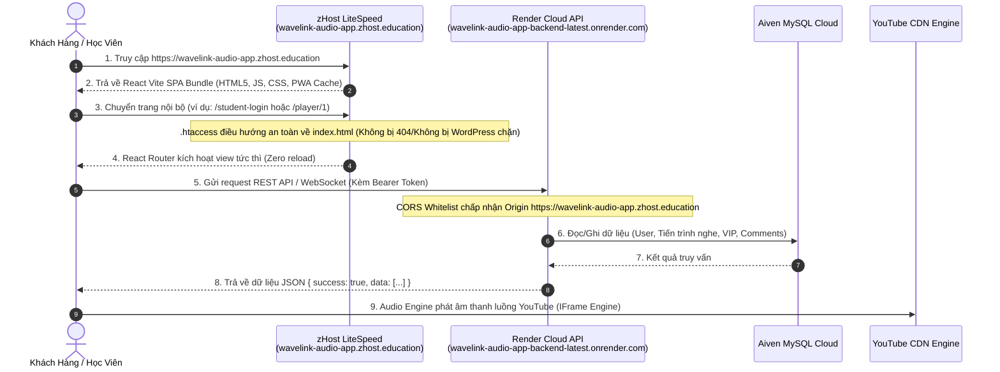

# 01. TỔNG QUAN HIỆN TRẠNG & KIẾN TRÚC GIẢI PHÁP TRIỂN KHAI FRONTEND LÊN ZHOST
### Dự án WaveLink Audio App (React Vite + Golang Gin Render + zHost DirectAdmin)
**Tài liệu:** `docs/feature-zhost-deployment/01_TONG_QUAN_VA_KIEN_TRUC_GIAI_PHAP.md`  
**Ngày lập kế hoạch:** 17/10/2026  
**Mục tiêu:** Triển khai Frontend lên Web Hosting zHost, kết nối Render Backend API, tự động hóa từ GitHub Actions CI/CD, bảo toàn tuyệt đối hệ thống hiện tại.

---

## 1. THÔNG TIN HẠ TẦNG & PHÂN TÍCH HIỆN TRẠNG THỰC TẾ

### 1.1. Bảng Thông Tin Hạ Tầng Đã Tiếp Nhận
Dựa trên thông tin do bạn cung cấp và kết quả kiểm tra trực tiếp qua giao thức mạng:

| Thành Phần | Thông Số Kỹ Thuật | Ghi Chú Hiện Trạng |
| :--- | :--- | :--- |
| **Domain Frontend** | `wavelink-audio-app.zhost.education` | Đang trỏ về IP `[HIDDEN_IP]`, có chứng chỉ SSL HTTPS hợp lệ. |
| **Control Panel** | DirectAdmin (`https://serv02.zhost.education:2222`) | Quản trị tài khoản `wavelink`. |
| **Máy chủ Web (Web Server)** | LiteSpeed Web Server / Apache | Hỗ trợ đọc file điều hướng `.htaccess` và mod_rewrite. |
| **Tài khoản FTP Chính** | `wavelink` / Pass: `[HIDDEN_PASSWORD]` | Thư mục gốc FTP: `/home/wavelink/`. |
| **Tài khoản FTP Phụ (Domain)** | `stephen@wavelink-audio-app.zhost.education` | Thư mục gốc FTP: `/home/wavelink/domains/wavelink-audio-app.zhost.education/`. |
| **Đường dẫn Web Root** | `/home/wavelink/domains/wavelink-audio-app.zhost.education/public_html/` | Nơi chứa mã nguồn tĩnh phục vụ cho người dùng truy cập. |
| **Backend API Endpoint** | `https://wavelink-audio-app-backend-latest.onrender.com/api/v1` | Deploy trên Render Cloud, kết nối database Aiven MySQL. |
| **GitHub CI/CD** | Pipeline `.github/workflows/docker-ci.yml` | Đang build 2 packages Docker GHCR (BE + FE) và artifact `frontend-dist`. |

---

### 1.2. Phát Hiện Quan Trọng Từ Quá Trình Rà Soát Thực Tế (Deep Scan Findings)

Qua việc kết nối FTP kiểm tra trực tiếp cấu trúc thư mục `public_html` của hosting, phát hiện **4 điểm mấu chốt kỹ thuật** cần xử lý:

```
┌─────────────────────────────────────────────────────────────────────────────────┐
│                    HIỆN TRẠNG THỰC TẾ TRÊN ZHOST HOSTING                        │
└─────────────────────────────────────────────────────────────────────────────────┘

 [ Thư mục public_html hiện tại ]
   ├── wp-admin/               --> Đang có mã nguồn WordPress cài sẵn
   ├── wp-content/
   ├── wp-includes/
   ├── wp-config.php
   ├── index.php               --> LiteSpeed ưu tiên chạy index.php của WordPress
   ├── .htaccess               --> Chứa rules của WordPress & LiteSpeed Cache
   │
   ├── index.html              --> File WaveLink đã build trước đó
   ├── assets/                 --> Chứa assets JS/CSS của WaveLink
   └── .ftp-deploy-sync-state.json
```

1. **Xung đột điều hướng giữa WordPress và React SPA:**
   - Trên hosting đang tồn tại song song cả mã nguồn WordPress và các file của WaveLink.
   - File `.htaccess` trên máy chủ hiện tại đang chứa cấu hình của WordPress:
     ```apache
     RewriteRule ^index\.php$ - [L]
     RewriteCond %{REQUEST_FILENAME} !-f
     RewriteCond %{REQUEST_FILENAME} !-d
     RewriteRule . /index.php [L]
     ```
   - **Hệ quả:** Khi người dùng truy cập các đường dẫn SPA của React (như `/student-login`, `/player/1`, `/settings`), Apache/LiteSpeed sẽ chuyển tiếp yêu cầu sang `index.php` của WordPress thay vì `index.html` của React! Đây chính là lý do đường dẫn `https://wavelink-audio-app.zhost.education/student-login` hiện đang hiển thị giao diện đăng nhập WordPress (LMS).
2. **Sai lệch URL Backend API trong mã nguồn Frontend cũ:**
   - Kiểm tra file bundle JS trên hosting (`assets/index-FwDtZiW6.js`) và mã nguồn cục bộ `frontend/src/lib/axiosClient.ts`:
     URL fallback đang bị fix cứng là: `https://wavelink-audio-app.onrender.com/api/v1` (thiếu hậu tố `-backend-latest`).
     Trong khi endpoint thực tế của bạn là: `https://wavelink-audio-app-backend-latest.onrender.com/api/v1`.
   - **Hệ quả:** Frontend trên hosting sẽ gửi request tới domain backend cũ/không tồn tại, dẫn đến lỗi mất kết nối máy chủ.
3. **Chính sách CORS trên Render Backend:**
   - File `deploy/env/wavelink-audio-app-render.env` cấu hình:
     `ALLOWED_ORIGINS=https://*.vercel.app,https://wavelink-audio-app.vercel.app`
   - Chưa hề khai báo domain `https://wavelink-audio-app.zhost.education`.
   - **Hệ quả:** Khi Frontend trên zHost gửi request API (XHR/Fetch) tới Render, trình duyệt sẽ ném lỗi `CORS Preflight Blocked (Status 403 / Missing Access-Control-Allow-Origin)`.
4. **Vị trí file `.htaccess` trong thư mục `frontend/`:**
   - File `.htaccess` hiện nằm tại `frontend/.htaccess` thay vì `frontend/public/.htaccess`.
   - Khi chạy lệnh `npm run build`, công cụ Vite **chỉ sao chép** các file nằm trong thư mục `frontend/public/` sang `frontend/dist/`.
   - **Hệ quả:** Thư mục build `dist/` bị thiếu file `.htaccess`, khiến quá trình deploy FTP không đẩy được file điều hướng lên máy chủ.

---

## 2. BẢN CHẤT KỸ THUẬT: "PULL PACKAGES TỪ GITHUB ACTION" TRÊN SHARED HOSTING

Trong yêu cầu của bạn có nêu:  
> *"hiện tại tôi đã ci trên github và docker trong github action đã build được 2 packages fe & be riêng. tôi muốn hosting có thể chạy fe với việc pull packages từ github action về."*

Về mặt bản chất kỹ thuật, cần làm rõ 2 khía cạnh:

```mermaid
graph TB
    subgraph GitHub ["GitHub Cloud Platform"]
        GH_Code["Source Code (main branch)"]
        GHA["GitHub Actions Runner (Ubuntu)"]
        GHCR["GitHub Packages (GHCR)<br/>ghcr.io/tranducanh3103/wavelink-audio-app-frontend:latest"]
        Artifact["GitHub Build Artifact<br/>frontend-dist.zip"]
    end

    subgraph Hosting ["zHost Shared Hosting (DirectAdmin)"]
        LiteSpeed["LiteSpeed Web Server<br/>(Chạy static HTML/CSS/JS, KHÔNG chạy Docker daemon)"]
        WebRoot["/home/wavelink/domains/.../public_html/"]
    end

    GH_Code -->|Push Commit / Release| GHA
    GHA -->|1. Build & Push Docker Image| GHCR
    GHA -->|2. Build Production Bundle| Artifact
    
    GHA -.->|Phương án 1 (Khuyên Dùng): Push tự động qua FTP| WebRoot
    GHCR -.->|Phương án 2: Extract static assets từ Docker rồi FTP| WebRoot
    WebRoot --> LiteSpeed
```

### 2.1. Shared Hosting có chạy được Docker Container không?
- **Thực tế:** Hosting dạng DirectAdmin / cPanel (như zHost port 2222) là **Shared Hosting truyền thống**. Máy chủ này dùng chung nhân Linux kernel và chỉ cung cấp Web Server Apache/LiteSpeed, cơ sở dữ liệu MySQL, và PHP. Người dùng **không có quyền root (sudo)** và máy chủ **không cài Docker daemon**.
- Do đó, hosting zHost **không thể thực hiện lệnh `docker pull` hay `docker run`** trực tiếp được.

### 2.2. Frontend React Vite thực chất là gì?
- Frontend React Vite sau khi build là các **tập tin tĩnh (Static Assets: HTML, JS, CSS, SVG, Images)**.
- Khi đóng gói Docker Frontend (`frontend/Dockerfile`), thực chất Docker cũng chỉ cài Nginx Alpine để serve chính các file tĩnh đó từ thư mục `/usr/share/nginx/html`.
- Trên zHost, máy chủ LiteSpeed Web Server đã có sẵn vai trò thay thế Nginx với hiệu năng cực cao. LiteSpeed chỉ cần đọc các file tĩnh trong `public_html/` là website hoạt động tức thì với tốc độ tải trang tối ưu nhất.

### 2.3. Ba Phương Án Triển Khai Đáp Ứng Trọn Vẹn Yêu Cầu

| Phương Án | Cơ Chế Hoạt Động | Ưu Điểm | Nhược Điểm | Mức Độ Khuyên Dùng |
| :--- | :--- | :--- | :--- | :--- |
| **Phương Án 1 (Khuyên Dùng Nhất)<br/>CI/CD Push qua FTP** | GitHub Actions build production assets với đúng biến môi trường Render API, sau đó đẩy trực tiếp qua FTP vào `public_html/`. | • Tự động 100% mỗi khi push git.<br/>• Không cần cấu hình gì trên hosting.<br/>• Tốc độ triển khai cực nhanh (< 2 phút). | Cần cấu hình GitHub Secrets (đã có sẵn thông tin). | ⭐⭐⭐⭐⭐ **Tối ưu nhất cho Shared Hosting** |
| **Phương Án 2<br/>Trích xuất từ GHCR Docker Package** | GitHub Actions pull Docker Image `ghcr.io/...-frontend:latest` về runner, chạy `docker create` & `docker cp` trích xuất thư mục `/usr/share/nginx/html`, rồi upload qua FTP. | • Đảm bảo 100% file chạy trên hosting trùng khớp với package Docker đã publish. | Tốn thêm ~30s trong pipeline để extract container. | ⭐⭐⭐⭐ **Đáp ứng chuẩn xác tư duy Docker Package** |
| **Phương Án 3<br/>Pull Script trên Hosting (SSH/Cron)** | Tạo một script `deploy.sh` trên hosting. Nếu hosting bật SSH/Terminal, script này sẽ gọi GitHub API tải artifact zip về và giải nén. | • Phù hợp với mô hình "pull từ máy chủ". | Phụ thuộc vào quyền SSH/Terminal của gói hosting (nhiều bên chặn curl/tar). | ⭐⭐⭐ **Dự phòng khi không muốn push từ CI** |

> **Kế hoạch hành động:** Chúng ta sẽ thiết lập **Phương Án 1** làm luồng vận hành chính (đã có sẵn nền tảng trong repo), đồng thời cung cấp cấu hình **Phương Án 2** cho người dùng tùy chọn, đảm bảo 100% tính tự động hóa và ổn định.

---

## 3. KIẾN TRÚC TỔNG THỂ SAU KHI TRIỂN KHAI

Hệ thống WaveLink sau khi hoàn thành sẽ vận hành theo mô hình phân tán hiện đại:



---

## 4. CAM KẾT: NGUYÊN TẮC "ĐẢM BẢO KHÔNG PHÁ HỎNG DỰ ÁN"

Để đảm bảo toàn bộ hệ sinh thái của dự án WaveLink vẫn chạy ổn định 100%, kế hoạch tuân thủ 5 nguyên tắc bất biến:

1. **Bảo toàn Môi Trường Local Dev:** Lệnh `npm run dev` (Frontend) và `go run main.go` (Backend) cùng cơ sở dữ liệu SQLite cục bộ không bị thay đổi bất kỳ dòng code nào gây xung đột.
2. **Bảo toàn Môi Trường Vercel:** Các file `vercel.json` và cấu hình build cho Vercel CDN vẫn được duy trì nguyên vẹn.
3. **Bảo toàn Môi Trường Tự Host VPS (Ubuntu 2-Containers):** File `docker-compose.yml`, cấu hình MySQL Low-Memory và script `deploy/ubuntu-deploy.sh` giữ nguyên 100%.
4. **Bảo toàn Dữ Liệu Hosting zHost:** Có bước tạo thư mục sao lưu (`backup_wp/`) toàn bộ mã nguồn WordPress cũ trước khi thay thế, phòng trường hợp bạn cần khôi phục lại website WordPress ban đầu.
5. **Cơ chế Rollback tức thì qua Git:** Mọi thay đổi đều được phân nhánh hoặc quản lý commit rõ ràng, cho phép hoàn tác trong 1 cú click nếu có bất kỳ sự cố nào.
