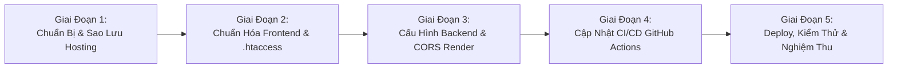

# 02. KẾ HOẠCH THỰC HIỆN TỪNG BƯỚC & CHECKLIST CHI TIẾT
### Triển khai Frontend WaveLink lên Hosting zHost (DirectAdmin / LiteSpeed)
**Tài liệu:** `docs/feature-zhost-deployment/02_KE_HOACH_THUC_HIEN_TUNG_BUOC.md`  
**Ngày lập:** 17/10/2026  
**Độ ưu tiên:** Cao  
**Mục tiêu:** Thực hiện theo lộ trình 5 giai đoạn có kiểm soát, kiểm thử chặt chẽ, không gián đoạn dịch vụ.

---

## 1. TỔNG QUAN LỘ TRÌNH 5 GIAI ĐOẠN



---

## 2. CHI TIẾT TỪNG GIAI ĐOẠN THỰC HIỆN

### GIAI ĐOẠN 1: CHUẨN BỊ, SAO LƯU & GIẢI QUYẾT XUNG ĐỘT TRÊN HOSTING ZHOST
> **Mục tiêu:** Bảo vệ dữ liệu hiện có trên hosting zHost, dọn dẹp mặt bằng để sẵn sàng đón nhận WaveLink React SPA mà không làm mất dữ liệu WordPress cũ.

- [ ] **Bước 1.1: Tạo thư mục sao lưu WordPress trên hosting (`public_html/wp_backup`)**
  - Đăng nhập DirectAdmin (`https://serv02.zhost.education:2222`) hoặc qua FTP (`stephen@wavelink-audio-app.zhost.education`).
  - Di chuyển các file WordPress (`wp-admin/`, `wp-content/`, `wp-includes/`, `wp-config.php`, `index.php`) vào một thư mục lưu trữ riêng (ví dụ: `/home/wavelink/domains/wavelink-audio-app.zhost.education/wp_backup/` hoặc giữ nguyên trong một subfolder `/student-portal/` nếu cần).
  - *Lợi ích:* Đảm bảo không làm mất dữ liệu học viên/bài viết WordPress cũ, có thể khôi phục bất cứ khi nào.
- [ ] **Bước 1.2: Chuẩn bị thư mục `public_html/` sạch**
  - Thư mục `public_html/` sẽ là nơi chỉ chứa các file của WaveLink: `index.html`, `assets/`, `sw.js`, `.htaccess`, favicon và static data.
- [ ] **Bước 1.3: Xác nhận tài khoản FTP và đường dẫn thư mục đích**
  - Nếu dùng tài khoản chính `FTP_USERNAME: wavelink`:
    - Thư mục root là `/home/wavelink/`.
    - Thư mục đích FTP (`server-dir`): `./domains/wavelink-audio-app.zhost.education/public_html/`.
  - Nếu dùng tài khoản phụ `FTP_USERNAME: stephen@wavelink-audio-app.zhost.education`:
    - Thư mục root đã là `/home/wavelink/domains/wavelink-audio-app.zhost.education/`.
    - Thư mục đích FTP (`server-dir`): `./public_html/`.
  - Khuyên dùng tài khoản `stephen@wavelink-audio-app.zhost.education` vì được phân quyền đúng domain, an toàn và ngắn gọn hơn.

---

### GIAI ĐOẠN 2: CHUẨN HÓA MÃ NGUỒN FRONTEND & CẤU HÌNH `.htaccess` SPA
> **Mục tiêu:** Đảm bảo mã nguồn Frontend được cấu hình đúng URL Backend, điều hướng SPA trơn tru và tự động đóng gói file `.htaccess` khi build.

- [ ] **Bước 2.1: Đồng bộ hóa file `.htaccess` vào `frontend/public/`**
  - Hiện tại file `.htaccess` đang ở `frontend/.htaccess`. Vite sẽ bỏ qua file này khi chạy `npm run build`.
  - Chuyển/Copy file vào `frontend/public/.htaccess` để Vite tự động copy sang `frontend/dist/.htaccess` trong mọi lần build.
- [ ] **Bước 2.2: Tinh chỉnh nội dung `.htaccess` chuẩn LiteSpeed & React Router**
  - Cấu hình bắt buộc:
    ```apache
    # 1. Bật Engine Rewrite
    RewriteEngine On
    RewriteBase /

    # 2. Bỏ qua nếu truy vấn đúng file tĩnh hoặc thư mục có thật (css, js, png, svg...)
    RewriteCond %{REQUEST_FILENAME} -f [OR]
    RewriteCond %{REQUEST_FILENAME} -d
    RewriteRule ^ - [L]

    # 3. Mọi đường dẫn ảo khác (như /student-login, /player/123) đều trả về index.html
    RewriteRule ^ index.html [L]
    ```
  - Bổ sung cấu hình tối ưu hiệu năng:
    - `mod_expires` & `mod_headers`: Caching 1 năm cho assets băm tên (`/assets/*.*`).
    - `no-cache` cho `index.html` và `sw.js` (Service Worker) để đảm bảo người dùng luôn nhận bản cập nhật mới nhất ngay lập tức mà không bị dính cache cũ của trình duyệt.
- [ ] **Bước 2.3: Cập nhật fallback API URL trong `frontend/src/lib/axiosClient.ts`**
  - Thay đổi đường dẫn mặc định từ:
    `'https://wavelink-audio-app.onrender.com/api/v1'`
    thành đúng endpoint thực tế:
    `'https://wavelink-audio-app-backend-latest.onrender.com/api/v1'`.
  - Điều này đảm bảo kể cả khi chạy độc lập không truyền ENV, Frontend vẫn trỏ chính xác về máy chủ Render Backend.
- [ ] **Bước 2.4: Kiểm thử cục bộ `npm run build`**
  - Chạy `npm run build` trong `frontend/`.
  - Kiểm tra xem thư mục `frontend/dist/` đã xuất hiện file `.htaccess` và bundle JS mới hay chưa.

---

### GIAI ĐOẠN 3: CẤU HÌNH CORS VÀ KẾT NỐI TRÊN RENDER BACKEND
> **Mục tiêu:** Cho phép Frontend từ domain `https://wavelink-audio-app.zhost.education` gọi API an toàn về Render Backend mà không bị trình duyệt chặn CORS.

- [ ] **Bước 3.1: Cập nhật biến môi trường trên Render Dashboard**
  - Đăng nhập [Render Dashboard](https://dashboard.render.com).
  - Chọn dịch vụ Backend: `wavelink-audio-app-backend-latest` (hoặc service tương ứng).
  - Vào mục **Environment** -> tìm biến `ALLOWED_ORIGINS`.
  - Bổ sung domain zHost vào danh sách cho phép (ngăn cách bởi dấu phẩy):
    ```env
    ALLOWED_ORIGINS=https://wavelink-audio-app.zhost.education,https://*.vercel.app,https://wavelink-audio-app.vercel.app,http://localhost:5173
    ```
  - Lưu và kích hoạt Redeploy để cấu hình có hiệu lực.
- [ ] **Bước 3.2: Cập nhật file cấu hình dự phòng trong repo**
  - Cập nhật file `deploy/env/wavelink-audio-app-render.env` và `deploy/env/env.render.example` để đồng bộ cấu hình vào tài liệu dự án.
- [ ] **Bước 3.3: Tối ưu Middleware CORS Backend (`backend/server/middleware/cors.go`)**
  - Kiểm tra logic CORS, đảm bảo xử lý chính xác cả domain cụ thể và header `Access-Control-Allow-Credentials: true` khi người dùng đăng nhập bằng JWT Token.

---

### GIAI ĐOẠN 4: NÂNG CẤP PIPELINE CI/CD TRÊN GITHUB ACTIONS
> **Mục tiêu:** Đóng gói Frontend với đúng biến môi trường Render, trích xuất/đẩy package tự động lên hosting zHost thông qua FTP Secrets.

- [ ] **Bước 4.1: Thiết lập GitHub Repository Secrets**
  - Vào repo trên GitHub: `Settings` -> `Secrets and variables` -> `Actions` -> `Repository secrets`.
  - Kiểm tra và đảm bảo đã nhập đủ các secrets:
    - `FTP_SERVER`: `[HIDDEN_IP]`
    - `FTP_USERNAME`: `stephen@wavelink-audio-app.zhost.education` (hoặc `wavelink`)
    - `FTP_PASSWORD`: `[HIDDEN_PASSWORD]`
    - `VITE_API_BASE_URL`: `https://wavelink-audio-app-backend-latest.onrender.com/api/v1`
- [ ] **Bước 4.2: Tinh chỉnh Workflow `.github/workflows/docker-ci.yml`**
  - Trong Job `frontend-test`:
    Truyền biến môi trường vào lệnh build:
    ```yaml
    - name: Verify Production Vite Build (TypeScript + Minification)
      working-directory: frontend
      env:
        VITE_API_BASE_URL: ${{ secrets.VITE_API_BASE_URL || 'https://wavelink-audio-app-backend-latest.onrender.com/api/v1' }}
        VITE_ITEMS_PER_PAGE: 12
      run: npm run build
    ```
  - Trong Job `docker-delivery`:
    Cập nhật bước build Docker Frontend với build-arg tương ứng.
  - Cập nhật bước Deploy FTP với đường dẫn chính xác theo tài khoản FTP:
    ```yaml
    - name: Deploy via FTP to zHost Hosting
      if: steps.check_ftp.outputs.enabled == 'true'
      uses: SamKirkland/FTP-Deploy-Action@v4.3.5
      with:
        server: ${{ secrets.FTP_SERVER }}
        username: ${{ secrets.FTP_USERNAME }}
        password: ${{ secrets.FTP_PASSWORD }}
        local-dir: ./frontend/dist/
        server-dir: ./public_html/
        dangerous-clean-slate: false
    ```
  - (Tùy chọn) Bổ sung bước **Package Verification**: Pull Docker image từ GHCR và verify tính toàn vẹn của gói bundle trước khi chuyển giao.

---

### GIAI ĐOẠN 5: KIỂM THỬ ĐẦU-CUỐI (END-TO-END) & BÀN GIAO
> **Mục tiêu:** Xác thực tất cả các tính năng cốt lõi của WaveLink trên domain `wavelink-audio-app.zhost.education`.

- [ ] **Kiểm thử 1: Tải trang tĩnh và PWA**
  - Truy cập `https://wavelink-audio-app.zhost.education`.
  - Kiểm tra DevTools (F12): Console không có lỗi 404 cho assets (JS, CSS, fonts, SVG).
- [ ] **Kiểm thử 2: Deep Link Refresh (SPA Routing)**
  - Nhập trực tiếp đường dẫn `https://wavelink-audio-app.zhost.education/student-login` trên trình duyệt và nhấn Enter (hoặc F5 reload).
  - Kết quả kỳ vọng: Giao diện đăng nhập của WaveLink hiển thị mượt mà, **không bị chuyển hướng sang WordPress** và không bị lỗi 404 của Apache.
- [ ] **Kiểm thử 3: Kết nối API Backend Render & CORS**
  - Thực hiện đăng nhập thử bằng tài khoản học viên/admin.
  - Mở tab Network: Request gửi tới `https://wavelink-audio-app-backend-latest.onrender.com/api/v1/auth/login`.
  - Kiểm tra phản hồi: Status 200 OK, Token JWT được cấp và lưu vào bộ nhớ trình duyệt.
- [ ] **Kiểm thử 4: Trình phát Audio Player**
  - Mở một bài giảng/audio bất kỳ, bấm Play.
  - Kiểm tra YouTube IFrame Engine phát mượt mà, tính năng tăng tốc x1.5, x2.0 hoạt động chuẩn xác theo cross-browser engine.
- [ ] **Kiểm thử 5: Tính năng Real-time WebSocket / Notifications**
  - Kiểm tra biểu tượng chuông thông báo và kết nối phòng thảo luận cộng đồng.

---

## 3. MA TRẬN RỦI RO & PHƯƠNG ÁN XỬ LÝ (RISK MATRIX)

| Rủi Ro Tiềm Ẩn | Khả Năng | Mức Ảnh Hưởng | Phương Án Phòng Ngừa & Khắc Phục |
| :--- | :---: | :---: | :--- |
| **Bị lỗi 404 khi F5 trang** | Cao | Cao | Bắt buộc đưa `.htaccess` vào `frontend/public/` để được build vào `dist/`. Cấu hình RewriteRule chuyển tất cả về `index.html`. |
| **Lỗi CORS khi gọi Render** | Cao | Cao | Bổ sung chính xác `https://wavelink-audio-app.zhost.education` vào biến `ALLOWED_ORIGINS` trên Render Dashboard trước khi deploy. |
| **WordPress chặn URL /student-login** | Trung bình | Cao | Di chuyển toàn bộ file WordPress cũ vào thư mục `wp_backup/` để tránh LiteSpeed ưu tiên chạy `index.php`. |
| **Deploy FTP ghi đè nhầm thư mục** | Thấp | Nghiêm trọng | Đặt `dangerous-clean-slate: false` trong FTP Action; kiểm tra kỹ `server-dir` giữa tài khoản `wavelink` và `stephen@...`. |
| **Render Backend bị Cold Sleep** | Trung bình | Thấp | Instance miễn phí của Render mất ~30-50s khởi động ở request đầu tiên. Frontend đã có sẵn thông báo "Đang kết nối máy chủ" và cơ chế retry tự động. |
