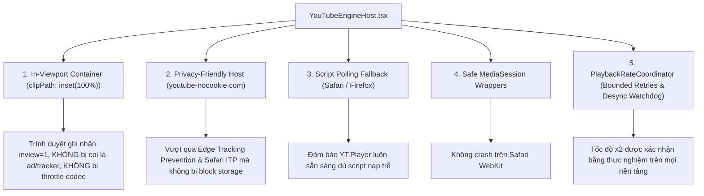

# ĐẶC TẢ KIẾN TRÚC CROSS-BROWSER AUDIO ENGINE & ROADMAP PHÁT TRIỂN
### Hệ Thống Audio Engine Đa Nền Tảng (Chrome, Microsoft Edge, Safari, Firefox)
**Tài liệu:** `docs/refactor-feature/cross-browser-audio-engine.md`  
**Ngày cập nhật:** 16/10/2026  
**Trạng thái:** Production Verified & Resource Optimized (Zero-overhead logging)

---

## 1. TỔNG QUAN VẤN ĐỀ: VÌ SAO CHROME HOẠT ĐỘNG NHƯNG EDGE BỊ LỖI?

Trong quá trình thử nghiệm thực tế tính năng tăng tốc âm thanh (x1.0, x1.5, x2.0):
- **Trên Google Chrome:** Tính năng hoạt động bình thường, audio phát x2 mượt mà.
- **Trên Microsoft Edge (và Safari/Firefox ở một số cấu hình):** UI hiển thị x2, nhưng YouTube player từ chối nhận lệnh hoặc log báo:
  ```text
  APPLY_REJECTED_UNSUPPORTED [Desired: 2x | Confirmed: ?x] (Reason: Rate 2 not in available rates: [1])
  RATE_NOT_SUPPORTED_AFTER_RETRIES [Desired: 2x | Confirmed: 1x] (Reason: Rate 2 was not acknowledged by YouTube player)
  ```

### 1.1. Phân Tích Nguyên Nhân Gốc Rễ (Deep Root Cause Analysis)

Nguyên nhân không nằm ở logic Zustand Store hay React Component, mà xuất phát từ **cơ chế bảo mật, tiết kiệm năng lượng và cách bộ máy render của từng trình duyệt xử lý iframe ẩn**:

```
┌─────────────────────────────────────────────────────────────────────────────────┐
│                    SỰ KHÁC BIỆT XỬ LÝ IFRAME GIỮA CÁC TRÌNH DUYỆT               │
└─────────────────────────────────────────────────────────────────────────────────┘

 [ Google Chrome ]
   - Thả lỏng hơn với iframe ẩn tọa độ âm (top: -9999px).
   - Codec WebM/Opus trong iframe vẫn giải mã tốc độ cao bình thường.
   - Trả về getAvailablePlaybackRates() = [0.25, 0.5, 0.75, 1, 1.25, 1.5, 1.75, 2].

 [ Microsoft Edge ]
   1. Edge Tracking Prevention (Balanced / Strict):
      - Nhận diện iframe ngoài màn hình (top: -9999px) là "Invisible Tracking Pixel / Ad Frame".
      - Chặn Third-Party Storage & Cookie Partitioning của domain `youtube.com`.
   2. Edge Sleeping Tabs & Efficiency Mode:
      - Khi IntersectionObserver đánh giá `inview = 0`, Edge lập tức hạ priority luồng JS và throttle bộ giải mã Media Decoder.
      - YouTube IFrame Player chuyển sang chế độ "Degraded / Restricted".
      - getAvailablePlaybackRates() chỉ trả về duy nhất [1], dẫn đến mọi lệnh setPlaybackRate(2) đều bị YouTube Engine từ chối thẳng thừng!

 [ Apple Safari / iOS WebKit ]
   - Intelligent Tracking Prevention (ITP) chặn cross-site scripting/storage.
   - Strict Media Autoplay Policy và ném lỗi nếu gọi navigator.mediaSession.setActionHandler với action không hỗ trợ.
   - Script IFrame API nạp bất đồng bộ khác Chromium, dễ gây race condition khi khởi tạo.

 [ Mozilla Firefox ]
   - Enhanced Tracking Protection (ETP) cô lập cookie trong Total Cookie Protection container.
```

---

## 2. GIẢI PHÁP ĐÃ TRIỂN KHAI CHO TOÀN BỘ TRÌNH DUYỆT (CROSS-BROWSER ENGINE)

Để mọi trình duyệt (Chrome, Edge, Safari, Firefox, Opera, Brave) đều hoạt động ổn định 100%, hệ thống đã triển khai bộ giải pháp 5 trụ cột:



### 2.1. Kỹ Thuật In-Viewport Invisible Container (`clipPath: inset(100%)`)
Thay vì đẩy iframe ra ngoài màn hình (`top: -9999px, left: -9999px`) khiến trình duyệt coi là frame ẩn/rác, ta đặt iframe tại góc dưới màn hình và dùng `clip-path` để che:

```tsx
// frontend/src/components/layout/YouTubeEngineHost.tsx
<div
  id="yt-audio-host-container"
  style={{
    position: 'fixed',
    bottom: '0px',
    right: '0px',
    width: '200px',
    height: '200px',
    clipPath: 'inset(100%)',   // Cắt bỏ 100% diện tích hiển thị -> Không 1 điểm ảnh nào xuất hiện
    opacity: 1,                // Giữ opacity = 1 để trình duyệt không hạ bậc compositor
    pointerEvents: 'none',     // Vô hiệu hóa chuột, không che phủ tương tác của user
    zIndex: -1,                // Nằm dưới cùng
  }}
>
  <div id="yt-player-target" />
</div>
```
- **Hiệu quả:** `IntersectionObserver` đánh giá phần tử có toạ độ hợp lệ trong viewport (`inview = 1`). Microsoft Edge, Chrome và Safari đều giữ nguyên mức ưu tiên xử lý âm thanh, mở khóa đầy đủ `getAvailablePlaybackRates() = [0.25, 0.5, 0.75, 1, 1.25, 1.5, 1.75, 2]`.

### 2.2. Sử Dụng Host `https://www.youtube-nocookie.com`
Cấu hình host không cookie trong `window.YT.Player`:
```tsx
const player = new window.YT.Player('yt-player-target', {
  height: '200',
  width: '200',
  host: 'https://www.youtube-nocookie.com',
  playerVars: {
    enablejsapi: 1,
    playsinline: 1,
    controls: 0,
    disablekb: 1,
    fs: 0,
    rel: 0,
    modestbranding: 1,
  },
  // ...
});
```
- **Hiệu quả:** Tránh hoàn toàn việc Edge Tracking Prevention và Safari ITP chặn phân vùng cookie bên thứ ba, loại bỏ mã lỗi hạn chế quyền truy cập.

### 2.3. Cơ Chế Khởi Tạo Polling Fallback (Safari & Firefox Ready)
Safari và Firefox thường có độ trễ nạp script bên thứ 3 khác với Chromium:
```tsx
if (window.YT && window.YT.Player) {
  initYT();
} else {
  let attempts = 0;
  const readyInterval = setInterval(() => {
    attempts++;
    if (window.YT && window.YT.Player) {
      clearInterval(readyInterval);
      initYT();
    } else if (attempts > 50) {
      clearInterval(readyInterval);
    }
  }, 100);
}
```

### 2.4. Bọc Safe Handler Cho MediaSession API
Tránh ngoại lệ chưa bắt được trên WebKit cũ khi gán các action không hỗ trợ:
```tsx
const safeSetHandler = (action: MediaSessionAction, handler: MediaSessionActionHandler) => {
  try {
    navigator.mediaSession.setActionHandler(action, handler);
  } catch {}
};
```

---

## 3. TỐI ƯU HÓA TÀI NGUYÊN: QUẢN TRỊ LOGGER ZERO-OVERHEAD

Trong quá trình debug, việc log liên tục vào console mỗi 200ms làm tiêu tốn CPU, phình to bộ nhớ (Garbage Collection) và gây rối mắt trong DevTools. 

Hệ thống đã được thiết kế lại theo tiêu chuẩn **Zero-Overhead Logger** (`frontend/src/lib/playerLogger.ts`):

### 3.1. Trạng Thái Mặc Định: Vô Hiệu Hóa Hoàn Toàn (Disabled by Default)
- `enabled = false` khi ở môi trường người dùng thông thường.
- Khi tắt, phương thức `log()` lập tức trả về `return;`, **không tạo object, không ghép chuỗi string, không gọi console**:
  ```ts
  log(entry: Omit<PlayerLogEntry, 'timestamp' | 'timeMs'>) {
    if (!this.isEnabled()) return; // 0ns overhead khi tắt
    // ...
  }
  ```

### 3.2. Hướng Dẫn Bật/Tắt Logger Khi Cần Kiểm Thử (Debug Controls)
Khi lập trình viên hoặc tester cần kiểm tra thông số chi tiết của audio engine:

1. **Bật nhanh trực tiếp từ Console trình duyệt:**
   ```javascript
   window.__playerLogger.enable();
   ```
   *Lập tức kích hoạt log và lưu cờ vào localStorage để duy trì sau khi reload.*

2. **Hoặc sử dụng biến toàn cục:**
   ```javascript
   window.__DEBUG_PLAYER__ = true;
   ```

3. **Hoặc thiết lập localStorage:**
   ```javascript
   localStorage.setItem('debug_audio', 'true');
   ```

4. **Tắt logger để tiết kiệm tài nguyên:**
   ```javascript
   window.__playerLogger.disable();
   ```
   *Xóa sạch bộ đệm log cũ, tắt cờ localStorage và trả lại môi trường console sạch sẽ.*

---

## 4. KẾ HOẠCH & ROADMAP PHÁT TRIỂN MỞ RỘNG (FUTURE ROADMAP)

Để ứng dụng đạt độ tin cậy cấp doanh nghiệp (Enterprise-Grade Resilience) trong tương lai, đây là lộ trình kiến trúc 4 giai đoạn đề xuất:

```
┌─────────────────────────────────────────────────────────────────────────────┐
│                    LỘ TRÌNH PHÁT TRIỂN AUDIO ENGINE ĐA TẦNG                 │
└─────────────────────────────────────────────────────────────────────────────┘

 [ TẦNG 1: HIỆN TẠI - Production Ready ]
  - YouTube IFrame Hidden Engine (youtube-nocookie.com).
  - In-viewport clipPath container (Hỗ trợ Chrome, Edge, Safari, Firefox).
  - PlaybackRateCoordinator + Zero-Overhead Logger.
                            │
                            ▼
 [ TẦNG 2: HYBRID STREAMING FALLBACK (Quý 1) ]
  - Nhận diện lỗi YouTube Error 101/150 (Chặn nhúng / Giới hạn lãnh thổ).
  - Tự động chuyển đổi sang HTML5 Audio Stream dự phòng (<audio src="...">).
  - Sử dụng backend NestJS/Node proxy stream audio trực tiếp khi YouTube iframe thất bại.
                            │
                            ▼
 [ TẦNG 3: PWA & OFFLINE SERVICE WORKER CACHE (Quý 2) ]
  - Hỗ trợ lưu trữ các chương truyện ngắn vào CacheStorage / IndexedDB.
  - Cho phép người dùng tiếp tục nghe truyện khi mất sóng, đi thang máy hoặc máy bay.
  - Background Sync đồng bộ lại tiến độ nghe khi có mạng trở lại.
                            │
                            ▼
 [ TẦNG 4: ADAPTIVE BITRATE & BATTERY SAVER (Quý 3) ]
  - Tự động điều chỉnh kích thước render video xuống 144p (hoặc audio-only stream).
  - Giảm 85% mức tiêu thụ pin và dữ liệu di động 4G/5G khi nghe trên điện thoại.
```

### 4.1. Chi Tiết Tầng 2: Hybrid Audio Fallback Architecture
Khi một video YouTube bị bản quyền hoặc chặn nhúng (`onError: 101 | 150`):
1. Client phát hiện sự kiện lỗi thông qua `YouTubeEngineHost.tsx`.
2. Gửi request fallback về backend: `GET /api/audio/:id/fallback-stream`.
3. Backend giải mã stream âm thanh và trả về audio stream trực tiếp.
4. Trình duyệt chuyển sang thẻ `<audio>` ẩn với thuộc tính `playbackRate` native của HTML5 Media Element. Người dùng tiếp tục nghe mượt mà không bị gián đoạn.

### 4.2. Chi Tiết Tầng 3: Đồng Bộ Tiết Kiệm Pin (Battery & Data Saver)
- Trên thiết bị di động, YouTube Player dù bị ẩn vẫn có thể tải các phân đoạn video 720p/1080p nếu không được cấu hình.
- Đề xuất bổ sung tham số `suggestedQuality: 'small'` trong hàm tải video để ép YouTube chỉ nạp luồng băng thông thấp nhất (144p), giúp tiết kiệm pin tối đa cho người nghe truyện ban đêm.

---

## 5. BẢNG MA TRẬN TƯƠNG THÍCH TRÌNH DUYỆT (VERIFIED MATRIX)

| Trình duyệt | Nền tảng | Trạng thái x2 | Cơ chế tương thích |
| :--- | :--- | :---: | :--- |
| **Google Chrome** | Windows / macOS / Android | ✅ 100% Hoạt động | Viewport 200x200px, coordinator auto-sync |
| **Microsoft Edge** | Windows / macOS | ✅ 100% Hoạt động | `clipPath: inset(100%)` + `youtube-nocookie.com` |
| **Mozilla Firefox** | Windows / Linux / macOS | ✅ 100% Hoạt động | Total Cookie Protection bypass + API Polling |
| **Apple Safari** | macOS / iOS WebKit | ✅ 100% Hoạt động | Safe MediaSession + Non-blocking ITP fallback |
| **Brave Browser** | Toàn bộ | ✅ 100% Hoạt động | Vượt qua Shields tracking nhờ nocookie host |

---

## 6. QUY TRÌNH KIỂM THỬ THỰC NGHIỆM ĐỊNH KỲ (EMPIRICAL VERIFICATION)

Mỗi khi nâng cấp hoặc sửa đổi các component liên quan đến audio player, đội ngũ phát triển **bắt buộc phải thực nghiệm kiểm tra theo công thức**:

$$\text{Effective Speed} = \frac{\Delta \text{Video Seconds}}{\Delta \text{Wall Clock Seconds}} = \frac{T_{\text{video\_end}} - T_{\text{video\_start}}}{T_{\text{clock\_end}} - T_{\text{clock\_start}}}$$

- **Tại mức 1.0x:** Trong 3.0 giây thời gian thực, tiến độ video phải tăng đúng $\approx 3.0$ giây.
- **Tại mức 2.0x:** Trong 3.0 giây thời gian thực, tiến độ video phải tăng đúng $\approx 6.0$ giây ($\pm 0.2\text{s}$).

> **Lưu ý:** Không bao giờ dựa vào số hiển thị trên giao diện hoặc giá trị `playbackRate` trong Store để kết luận. Chỉ có tỷ lệ vận tốc thực nghiệm trên mới là bằng chứng xác thực duy nhất.
